# Executable finite-state transducer specification

Generated with `python -m scripts.document_transducers`. Do not edit the generated tables.

The program uses one nondeterministic FST. Each alias contributes a separate character route, sharing only the start state and accepting state. Multiple routes may accept the same input but produce the same canonical token. There are no epsilon-input transitions.

Each section below shows the part of the FST that produces one output token. To combine these parts into the complete FST, rename every internal state with its token prefix, then merge the shared q0 and q_aceptacion states. State numbers within each section are local. No transitions between internal states of different sections exist.

For each section M = (Q, Sigma, Gamma, delta, omega, q0, F). The table defines delta and omega jointly: a row (p, a, q, w) means an edge p --a/w--> q. Absent edges reject. Output epsilon means the empty word, not an input transition. Letters accept both ASCII cases. An alias space accepts one or more spaces/tabs through a consuming self-loop. Only the last character emits the complete canonical token.

Unknown terms have no accepting path. The wrapper removes duplicate output tokens and sorts them; profile-specific ordering happens later. JAVA, MYSQL and MONGODB are retained as skills but do not change any profile's acceptance requirements.

The PNGs under GRAPHICS show an earlier version. Use the Mermaid diagrams below for the current model.

## AIRFLOW

Aliases: `Airflow`, `airflow`, `Apache Airflow`

- Q = {q0, q1, q10, q11, q12, q13, q15, q16, q17, q18, q19, q2, q20, q21, q22, q23, q24, q25, q26, q27, q3, q4, q5, q6, q8, q9, q_aceptacion}
- Sigma = {'\t', ' ', 'A', 'C', 'E', 'F', 'H', 'I', 'L', 'O', 'P', 'R', 'W', 'a', 'c', 'e', 'f', 'h', 'i', 'l', 'o', 'p', 'r', 'w'}
- Gamma = {A, F, I, L, O, R, W}
- Initial state: q0
- F = {q_aceptacion}

| Source | Input alternatives | Destination | Output word |
|---|---|---|---|
| q0 | `A, a` | q1 | epsilon |
| q0 | `A, a` | q15 | epsilon |
| q0 | `A, a` | q8 | epsilon |
| q1 | `I, i` | q2 | epsilon |
| q10 | `F, f` | q11 | epsilon |
| q11 | `L, l` | q12 | epsilon |
| q12 | `O, o` | q13 | epsilon |
| q13 | `W, w` | q_aceptacion | AIRFLOW |
| q15 | `P, p` | q16 | epsilon |
| q16 | `A, a` | q17 | epsilon |
| q17 | `C, c` | q18 | epsilon |
| q18 | `H, h` | q19 | epsilon |
| q19 | `E, e` | q20 | epsilon |
| q2 | `R, r` | q3 | epsilon |
| q20 | `TAB, SPACE` | q21 | epsilon |
| q21 | `TAB, SPACE` | q21 | epsilon |
| q21 | `A, a` | q22 | epsilon |
| q22 | `I, i` | q23 | epsilon |
| q23 | `R, r` | q24 | epsilon |
| q24 | `F, f` | q25 | epsilon |
| q25 | `L, l` | q26 | epsilon |
| q26 | `O, o` | q27 | epsilon |
| q27 | `W, w` | q_aceptacion | AIRFLOW |
| q3 | `F, f` | q4 | epsilon |
| q4 | `L, l` | q5 | epsilon |
| q5 | `O, o` | q6 | epsilon |
| q6 | `W, w` | q_aceptacion | AIRFLOW |
| q8 | `I, i` | q9 | epsilon |
| q9 | `R, r` | q10 | epsilon |

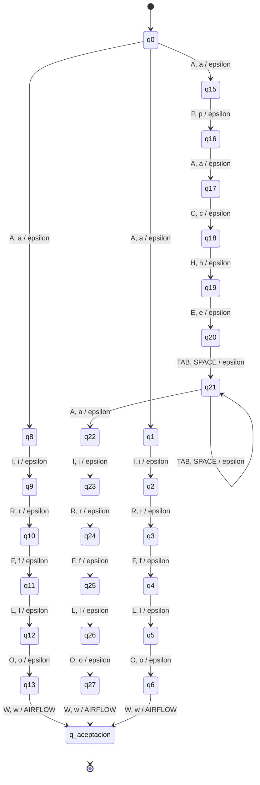

## ANGULAR

Aliases: `Angular.js`, `AngularJS`, `angular`, `Angular`

- Q = {q0, q1, q11, q12, q13, q14, q15, q16, q17, q18, q2, q20, q21, q22, q23, q24, q25, q27, q28, q29, q3, q30, q31, q32, q4, q5, q6, q7, q8, q9, q_aceptacion}
- Sigma = {'.', 'A', 'G', 'J', 'L', 'N', 'R', 'S', 'U', 'a', 'g', 'j', 'l', 'n', 'r', 's', 'u'}
- Gamma = {A, G, L, N, R, U}
- Initial state: q0
- F = {q_aceptacion}

| Source | Input alternatives | Destination | Output word |
|---|---|---|---|
| q0 | `A, a` | q1 | epsilon |
| q0 | `A, a` | q11 | epsilon |
| q0 | `A, a` | q20 | epsilon |
| q0 | `A, a` | q27 | epsilon |
| q1 | `N, n` | q2 | epsilon |
| q11 | `N, n` | q12 | epsilon |
| q12 | `G, g` | q13 | epsilon |
| q13 | `U, u` | q14 | epsilon |
| q14 | `L, l` | q15 | epsilon |
| q15 | `A, a` | q16 | epsilon |
| q16 | `R, r` | q17 | epsilon |
| q17 | `J, j` | q18 | epsilon |
| q18 | `S, s` | q_aceptacion | ANGULAR |
| q2 | `G, g` | q3 | epsilon |
| q20 | `N, n` | q21 | epsilon |
| q21 | `G, g` | q22 | epsilon |
| q22 | `U, u` | q23 | epsilon |
| q23 | `L, l` | q24 | epsilon |
| q24 | `A, a` | q25 | epsilon |
| q25 | `R, r` | q_aceptacion | ANGULAR |
| q27 | `N, n` | q28 | epsilon |
| q28 | `G, g` | q29 | epsilon |
| q29 | `U, u` | q30 | epsilon |
| q3 | `U, u` | q4 | epsilon |
| q30 | `L, l` | q31 | epsilon |
| q31 | `A, a` | q32 | epsilon |
| q32 | `R, r` | q_aceptacion | ANGULAR |
| q4 | `L, l` | q5 | epsilon |
| q5 | `A, a` | q6 | epsilon |
| q6 | `R, r` | q7 | epsilon |
| q7 | `.` | q8 | epsilon |
| q8 | `J, j` | q9 | epsilon |
| q9 | `S, s` | q_aceptacion | ANGULAR |

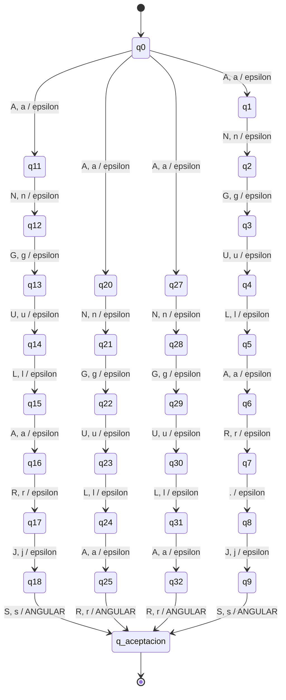

## AWS

Aliases: `AWS`, `aws`, `Amazon Web Services`, `amazon web services`

- Q = {q0, q1, q10, q11, q12, q13, q14, q15, q16, q17, q18, q19, q2, q20, q21, q22, q23, q24, q26, q27, q28, q29, q30, q31, q32, q33, q34, q35, q36, q37, q38, q39, q4, q40, q41, q42, q43, q5, q7, q8, q9, q_aceptacion}
- Sigma = {'\t', ' ', 'A', 'B', 'C', 'E', 'I', 'M', 'N', 'O', 'R', 'S', 'V', 'W', 'Z', 'a', 'b', 'c', 'e', 'i', 'm', 'n', 'o', 'r', 's', 'v', 'w', 'z'}
- Gamma = {A, S, W}
- Initial state: q0
- F = {q_aceptacion}

| Source | Input alternatives | Destination | Output word |
|---|---|---|---|
| q0 | `A, a` | q1 | epsilon |
| q0 | `A, a` | q26 | epsilon |
| q0 | `A, a` | q4 | epsilon |
| q0 | `A, a` | q7 | epsilon |
| q1 | `W, w` | q2 | epsilon |
| q10 | `O, o` | q11 | epsilon |
| q11 | `N, n` | q12 | epsilon |
| q12 | `TAB, SPACE` | q13 | epsilon |
| q13 | `TAB, SPACE` | q13 | epsilon |
| q13 | `W, w` | q14 | epsilon |
| q14 | `E, e` | q15 | epsilon |
| q15 | `B, b` | q16 | epsilon |
| q16 | `TAB, SPACE` | q17 | epsilon |
| q17 | `TAB, SPACE` | q17 | epsilon |
| q17 | `S, s` | q18 | epsilon |
| q18 | `E, e` | q19 | epsilon |
| q19 | `R, r` | q20 | epsilon |
| q2 | `S, s` | q_aceptacion | AWS |
| q20 | `V, v` | q21 | epsilon |
| q21 | `I, i` | q22 | epsilon |
| q22 | `C, c` | q23 | epsilon |
| q23 | `E, e` | q24 | epsilon |
| q24 | `S, s` | q_aceptacion | AWS |
| q26 | `M, m` | q27 | epsilon |
| q27 | `A, a` | q28 | epsilon |
| q28 | `Z, z` | q29 | epsilon |
| q29 | `O, o` | q30 | epsilon |
| q30 | `N, n` | q31 | epsilon |
| q31 | `TAB, SPACE` | q32 | epsilon |
| q32 | `TAB, SPACE` | q32 | epsilon |
| q32 | `W, w` | q33 | epsilon |
| q33 | `E, e` | q34 | epsilon |
| q34 | `B, b` | q35 | epsilon |
| q35 | `TAB, SPACE` | q36 | epsilon |
| q36 | `TAB, SPACE` | q36 | epsilon |
| q36 | `S, s` | q37 | epsilon |
| q37 | `E, e` | q38 | epsilon |
| q38 | `R, r` | q39 | epsilon |
| q39 | `V, v` | q40 | epsilon |
| q4 | `W, w` | q5 | epsilon |
| q40 | `I, i` | q41 | epsilon |
| q41 | `C, c` | q42 | epsilon |
| q42 | `E, e` | q43 | epsilon |
| q43 | `S, s` | q_aceptacion | AWS |
| q5 | `S, s` | q_aceptacion | AWS |
| q7 | `M, m` | q8 | epsilon |
| q8 | `A, a` | q9 | epsilon |
| q9 | `Z, z` | q10 | epsilon |

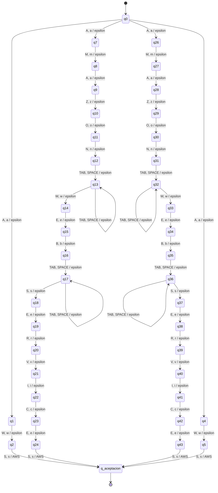

## AZURE

Aliases: `Azure`, `Microsoft Azure`, `azure`

- Q = {q0, q1, q10, q11, q12, q13, q14, q15, q16, q17, q18, q19, q2, q21, q22, q23, q24, q3, q4, q6, q7, q8, q9, q_aceptacion}
- Sigma = {'\t', ' ', 'A', 'C', 'E', 'F', 'I', 'M', 'O', 'R', 'S', 'T', 'U', 'Z', 'a', 'c', 'e', 'f', 'i', 'm', 'o', 'r', 's', 't', 'u', 'z'}
- Gamma = {A, E, R, U, Z}
- Initial state: q0
- F = {q_aceptacion}

| Source | Input alternatives | Destination | Output word |
|---|---|---|---|
| q0 | `A, a` | q1 | epsilon |
| q0 | `A, a` | q21 | epsilon |
| q0 | `M, m` | q6 | epsilon |
| q1 | `Z, z` | q2 | epsilon |
| q10 | `S, s` | q11 | epsilon |
| q11 | `O, o` | q12 | epsilon |
| q12 | `F, f` | q13 | epsilon |
| q13 | `T, t` | q14 | epsilon |
| q14 | `TAB, SPACE` | q15 | epsilon |
| q15 | `TAB, SPACE` | q15 | epsilon |
| q15 | `A, a` | q16 | epsilon |
| q16 | `Z, z` | q17 | epsilon |
| q17 | `U, u` | q18 | epsilon |
| q18 | `R, r` | q19 | epsilon |
| q19 | `E, e` | q_aceptacion | AZURE |
| q2 | `U, u` | q3 | epsilon |
| q21 | `Z, z` | q22 | epsilon |
| q22 | `U, u` | q23 | epsilon |
| q23 | `R, r` | q24 | epsilon |
| q24 | `E, e` | q_aceptacion | AZURE |
| q3 | `R, r` | q4 | epsilon |
| q4 | `E, e` | q_aceptacion | AZURE |
| q6 | `I, i` | q7 | epsilon |
| q7 | `C, c` | q8 | epsilon |
| q8 | `R, r` | q9 | epsilon |
| q9 | `O, o` | q10 | epsilon |

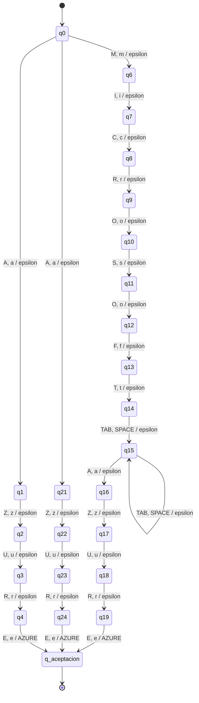

## CI_CD

Aliases: `CI/CD`, `ci/cd`, `CI-CD`

- Q = {q0, q1, q11, q12, q13, q14, q2, q3, q4, q6, q7, q8, q9, q_aceptacion}
- Sigma = {'-', '/', 'C', 'D', 'I', 'c', 'd', 'i'}
- Gamma = {C, D, I, _}
- Initial state: q0
- F = {q_aceptacion}

| Source | Input alternatives | Destination | Output word |
|---|---|---|---|
| q0 | `C, c` | q1 | epsilon |
| q0 | `C, c` | q11 | epsilon |
| q0 | `C, c` | q6 | epsilon |
| q1 | `I, i` | q2 | epsilon |
| q11 | `I, i` | q12 | epsilon |
| q12 | `-` | q13 | epsilon |
| q13 | `C, c` | q14 | epsilon |
| q14 | `D, d` | q_aceptacion | CI_CD |
| q2 | `/` | q3 | epsilon |
| q3 | `C, c` | q4 | epsilon |
| q4 | `D, d` | q_aceptacion | CI_CD |
| q6 | `I, i` | q7 | epsilon |
| q7 | `/` | q8 | epsilon |
| q8 | `C, c` | q9 | epsilon |
| q9 | `D, d` | q_aceptacion | CI_CD |

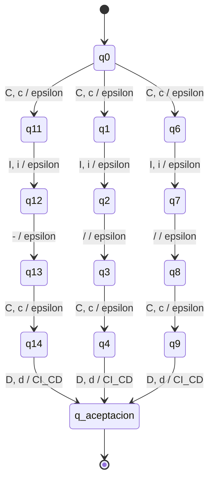

## DATA_WAREHOUSE

Aliases: `Data Warehouse`, `data warehouse`, `DW`, `DWH`

- Q = {q0, q1, q10, q11, q12, q13, q15, q16, q17, q18, q19, q2, q20, q21, q22, q23, q24, q25, q26, q27, q29, q3, q31, q32, q4, q5, q6, q7, q8, q9, q_aceptacion}
- Sigma = {'\t', ' ', 'A', 'D', 'E', 'H', 'O', 'R', 'S', 'T', 'U', 'W', 'a', 'd', 'e', 'h', 'o', 'r', 's', 't', 'u', 'w'}
- Gamma = {A, D, E, H, O, R, S, T, U, W, _}
- Initial state: q0
- F = {q_aceptacion}

| Source | Input alternatives | Destination | Output word |
|---|---|---|---|
| q0 | `D, d` | q1 | epsilon |
| q0 | `D, d` | q15 | epsilon |
| q0 | `D, d` | q29 | epsilon |
| q0 | `D, d` | q31 | epsilon |
| q1 | `A, a` | q2 | epsilon |
| q10 | `O, o` | q11 | epsilon |
| q11 | `U, u` | q12 | epsilon |
| q12 | `S, s` | q13 | epsilon |
| q13 | `E, e` | q_aceptacion | DATA_WAREHOUSE |
| q15 | `A, a` | q16 | epsilon |
| q16 | `T, t` | q17 | epsilon |
| q17 | `A, a` | q18 | epsilon |
| q18 | `TAB, SPACE` | q19 | epsilon |
| q19 | `TAB, SPACE` | q19 | epsilon |
| q19 | `W, w` | q20 | epsilon |
| q2 | `T, t` | q3 | epsilon |
| q20 | `A, a` | q21 | epsilon |
| q21 | `R, r` | q22 | epsilon |
| q22 | `E, e` | q23 | epsilon |
| q23 | `H, h` | q24 | epsilon |
| q24 | `O, o` | q25 | epsilon |
| q25 | `U, u` | q26 | epsilon |
| q26 | `S, s` | q27 | epsilon |
| q27 | `E, e` | q_aceptacion | DATA_WAREHOUSE |
| q29 | `W, w` | q_aceptacion | DATA_WAREHOUSE |
| q3 | `A, a` | q4 | epsilon |
| q31 | `W, w` | q32 | epsilon |
| q32 | `H, h` | q_aceptacion | DATA_WAREHOUSE |
| q4 | `TAB, SPACE` | q5 | epsilon |
| q5 | `TAB, SPACE` | q5 | epsilon |
| q5 | `W, w` | q6 | epsilon |
| q6 | `A, a` | q7 | epsilon |
| q7 | `R, r` | q8 | epsilon |
| q8 | `E, e` | q9 | epsilon |
| q9 | `H, h` | q10 | epsilon |

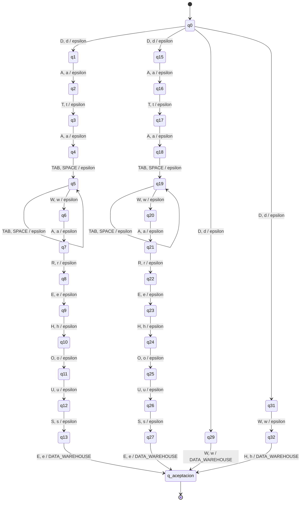

## DJANGO

Aliases: `django`, `Django`

- Q = {q0, q1, q10, q11, q2, q3, q4, q5, q7, q8, q9, q_aceptacion}
- Sigma = {'A', 'D', 'G', 'J', 'N', 'O', 'a', 'd', 'g', 'j', 'n', 'o'}
- Gamma = {A, D, G, J, N, O}
- Initial state: q0
- F = {q_aceptacion}

| Source | Input alternatives | Destination | Output word |
|---|---|---|---|
| q0 | `D, d` | q1 | epsilon |
| q0 | `D, d` | q7 | epsilon |
| q1 | `J, j` | q2 | epsilon |
| q10 | `G, g` | q11 | epsilon |
| q11 | `O, o` | q_aceptacion | DJANGO |
| q2 | `A, a` | q3 | epsilon |
| q3 | `N, n` | q4 | epsilon |
| q4 | `G, g` | q5 | epsilon |
| q5 | `O, o` | q_aceptacion | DJANGO |
| q7 | `J, j` | q8 | epsilon |
| q8 | `A, a` | q9 | epsilon |
| q9 | `N, n` | q10 | epsilon |

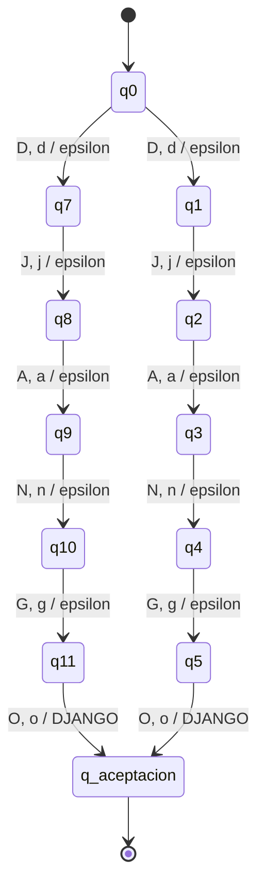

## DOCKER

Aliases: `Docker`, `docker`

- Q = {q0, q1, q10, q11, q2, q3, q4, q5, q7, q8, q9, q_aceptacion}
- Sigma = {'C', 'D', 'E', 'K', 'O', 'R', 'c', 'd', 'e', 'k', 'o', 'r'}
- Gamma = {C, D, E, K, O, R}
- Initial state: q0
- F = {q_aceptacion}

| Source | Input alternatives | Destination | Output word |
|---|---|---|---|
| q0 | `D, d` | q1 | epsilon |
| q0 | `D, d` | q7 | epsilon |
| q1 | `O, o` | q2 | epsilon |
| q10 | `E, e` | q11 | epsilon |
| q11 | `R, r` | q_aceptacion | DOCKER |
| q2 | `C, c` | q3 | epsilon |
| q3 | `K, k` | q4 | epsilon |
| q4 | `E, e` | q5 | epsilon |
| q5 | `R, r` | q_aceptacion | DOCKER |
| q7 | `O, o` | q8 | epsilon |
| q8 | `C, c` | q9 | epsilon |
| q9 | `K, k` | q10 | epsilon |

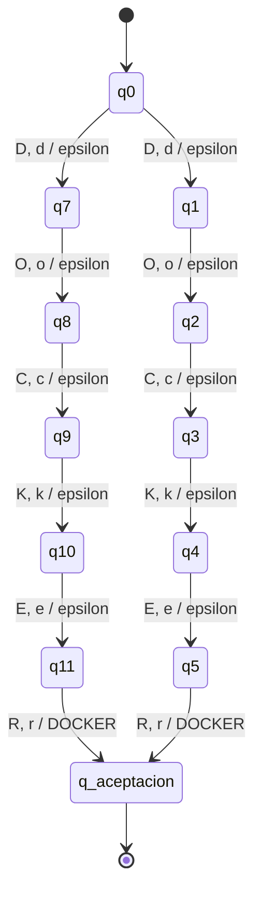

## ETL

Aliases: `ETL`, `etl`, `Extract Transform Load`

- Q = {q0, q1, q10, q11, q12, q13, q14, q15, q16, q17, q18, q19, q2, q20, q21, q22, q23, q24, q25, q26, q27, q4, q5, q7, q8, q9, q_aceptacion}
- Sigma = {'\t', ' ', 'A', 'C', 'D', 'E', 'F', 'L', 'M', 'N', 'O', 'R', 'S', 'T', 'X', 'a', 'c', 'd', 'e', 'f', 'l', 'm', 'n', 'o', 'r', 's', 't', 'x'}
- Gamma = {E, L, T}
- Initial state: q0
- F = {q_aceptacion}

| Source | Input alternatives | Destination | Output word |
|---|---|---|---|
| q0 | `E, e` | q1 | epsilon |
| q0 | `E, e` | q4 | epsilon |
| q0 | `E, e` | q7 | epsilon |
| q1 | `T, t` | q2 | epsilon |
| q10 | `A, a` | q11 | epsilon |
| q11 | `C, c` | q12 | epsilon |
| q12 | `T, t` | q13 | epsilon |
| q13 | `TAB, SPACE` | q14 | epsilon |
| q14 | `TAB, SPACE` | q14 | epsilon |
| q14 | `T, t` | q15 | epsilon |
| q15 | `R, r` | q16 | epsilon |
| q16 | `A, a` | q17 | epsilon |
| q17 | `N, n` | q18 | epsilon |
| q18 | `S, s` | q19 | epsilon |
| q19 | `F, f` | q20 | epsilon |
| q2 | `L, l` | q_aceptacion | ETL |
| q20 | `O, o` | q21 | epsilon |
| q21 | `R, r` | q22 | epsilon |
| q22 | `M, m` | q23 | epsilon |
| q23 | `TAB, SPACE` | q24 | epsilon |
| q24 | `TAB, SPACE` | q24 | epsilon |
| q24 | `L, l` | q25 | epsilon |
| q25 | `O, o` | q26 | epsilon |
| q26 | `A, a` | q27 | epsilon |
| q27 | `D, d` | q_aceptacion | ETL |
| q4 | `T, t` | q5 | epsilon |
| q5 | `L, l` | q_aceptacion | ETL |
| q7 | `X, x` | q8 | epsilon |
| q8 | `T, t` | q9 | epsilon |
| q9 | `R, r` | q10 | epsilon |

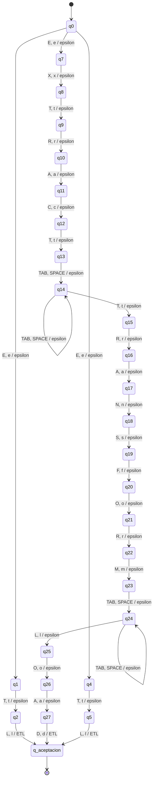

## GCP

Aliases: `GCP`, `gcp`, `Google Cloud`, `google cloud`, `Google Cloud Platform`, `google cloud platform`

- Q = {q0, q1, q10, q11, q12, q13, q14, q15, q16, q17, q19, q2, q20, q21, q22, q23, q24, q25, q26, q27, q28, q29, q31, q32, q33, q34, q35, q36, q37, q38, q39, q4, q40, q41, q42, q43, q44, q45, q46, q47, q48, q49, q5, q50, q52, q53, q54, q55, q56, q57, q58, q59, q60, q61, q62, q63, q64, q65, q66, q67, q68, q69, q7, q70, q71, q8, q9, q_aceptacion}
- Sigma = {'\t', ' ', 'A', 'C', 'D', 'E', 'F', 'G', 'L', 'M', 'O', 'P', 'R', 'T', 'U', 'a', 'c', 'd', 'e', 'f', 'g', 'l', 'm', 'o', 'p', 'r', 't', 'u'}
- Gamma = {C, G, P}
- Initial state: q0
- F = {q_aceptacion}

| Source | Input alternatives | Destination | Output word |
|---|---|---|---|
| q0 | `G, g` | q1 | epsilon |
| q0 | `G, g` | q19 | epsilon |
| q0 | `G, g` | q31 | epsilon |
| q0 | `G, g` | q4 | epsilon |
| q0 | `G, g` | q52 | epsilon |
| q0 | `G, g` | q7 | epsilon |
| q1 | `C, c` | q2 | epsilon |
| q10 | `L, l` | q11 | epsilon |
| q11 | `E, e` | q12 | epsilon |
| q12 | `TAB, SPACE` | q13 | epsilon |
| q13 | `TAB, SPACE` | q13 | epsilon |
| q13 | `C, c` | q14 | epsilon |
| q14 | `L, l` | q15 | epsilon |
| q15 | `O, o` | q16 | epsilon |
| q16 | `U, u` | q17 | epsilon |
| q17 | `D, d` | q_aceptacion | GCP |
| q19 | `O, o` | q20 | epsilon |
| q2 | `P, p` | q_aceptacion | GCP |
| q20 | `O, o` | q21 | epsilon |
| q21 | `G, g` | q22 | epsilon |
| q22 | `L, l` | q23 | epsilon |
| q23 | `E, e` | q24 | epsilon |
| q24 | `TAB, SPACE` | q25 | epsilon |
| q25 | `TAB, SPACE` | q25 | epsilon |
| q25 | `C, c` | q26 | epsilon |
| q26 | `L, l` | q27 | epsilon |
| q27 | `O, o` | q28 | epsilon |
| q28 | `U, u` | q29 | epsilon |
| q29 | `D, d` | q_aceptacion | GCP |
| q31 | `O, o` | q32 | epsilon |
| q32 | `O, o` | q33 | epsilon |
| q33 | `G, g` | q34 | epsilon |
| q34 | `L, l` | q35 | epsilon |
| q35 | `E, e` | q36 | epsilon |
| q36 | `TAB, SPACE` | q37 | epsilon |
| q37 | `TAB, SPACE` | q37 | epsilon |
| q37 | `C, c` | q38 | epsilon |
| q38 | `L, l` | q39 | epsilon |
| q39 | `O, o` | q40 | epsilon |
| q4 | `C, c` | q5 | epsilon |
| q40 | `U, u` | q41 | epsilon |
| q41 | `D, d` | q42 | epsilon |
| q42 | `TAB, SPACE` | q43 | epsilon |
| q43 | `TAB, SPACE` | q43 | epsilon |
| q43 | `P, p` | q44 | epsilon |
| q44 | `L, l` | q45 | epsilon |
| q45 | `A, a` | q46 | epsilon |
| q46 | `T, t` | q47 | epsilon |
| q47 | `F, f` | q48 | epsilon |
| q48 | `O, o` | q49 | epsilon |
| q49 | `R, r` | q50 | epsilon |
| q5 | `P, p` | q_aceptacion | GCP |
| q50 | `M, m` | q_aceptacion | GCP |
| q52 | `O, o` | q53 | epsilon |
| q53 | `O, o` | q54 | epsilon |
| q54 | `G, g` | q55 | epsilon |
| q55 | `L, l` | q56 | epsilon |
| q56 | `E, e` | q57 | epsilon |
| q57 | `TAB, SPACE` | q58 | epsilon |
| q58 | `TAB, SPACE` | q58 | epsilon |
| q58 | `C, c` | q59 | epsilon |
| q59 | `L, l` | q60 | epsilon |
| q60 | `O, o` | q61 | epsilon |
| q61 | `U, u` | q62 | epsilon |
| q62 | `D, d` | q63 | epsilon |
| q63 | `TAB, SPACE` | q64 | epsilon |
| q64 | `TAB, SPACE` | q64 | epsilon |
| q64 | `P, p` | q65 | epsilon |
| q65 | `L, l` | q66 | epsilon |
| q66 | `A, a` | q67 | epsilon |
| q67 | `T, t` | q68 | epsilon |
| q68 | `F, f` | q69 | epsilon |
| q69 | `O, o` | q70 | epsilon |
| q7 | `O, o` | q8 | epsilon |
| q70 | `R, r` | q71 | epsilon |
| q71 | `M, m` | q_aceptacion | GCP |
| q8 | `O, o` | q9 | epsilon |
| q9 | `G, g` | q10 | epsilon |

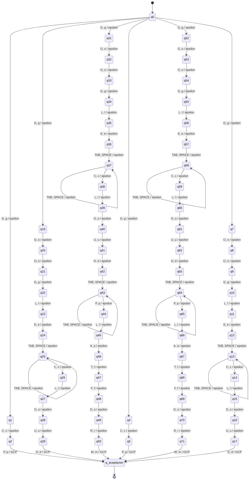

## GIT

Aliases: `Git`, `git`, `GIT`

- Q = {q0, q1, q2, q4, q5, q7, q8, q_aceptacion}
- Sigma = {'G', 'I', 'T', 'g', 'i', 't'}
- Gamma = {G, I, T}
- Initial state: q0
- F = {q_aceptacion}

| Source | Input alternatives | Destination | Output word |
|---|---|---|---|
| q0 | `G, g` | q1 | epsilon |
| q0 | `G, g` | q4 | epsilon |
| q0 | `G, g` | q7 | epsilon |
| q1 | `I, i` | q2 | epsilon |
| q2 | `T, t` | q_aceptacion | GIT |
| q4 | `I, i` | q5 | epsilon |
| q5 | `T, t` | q_aceptacion | GIT |
| q7 | `I, i` | q8 | epsilon |
| q8 | `T, t` | q_aceptacion | GIT |

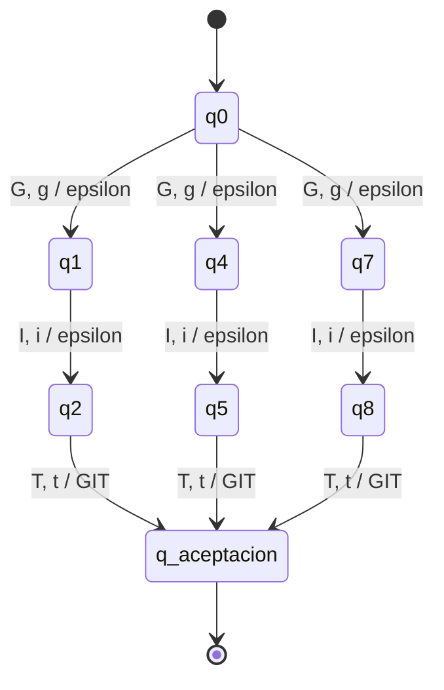

## GITHUB_ACTIONS

Aliases: `GitHub Actions`, `Github Actions`, `github actions`

- Q = {q0, q1, q10, q11, q12, q13, q15, q16, q17, q18, q19, q2, q20, q21, q22, q23, q24, q25, q26, q27, q29, q3, q30, q31, q32, q33, q34, q35, q36, q37, q38, q39, q4, q40, q41, q5, q6, q7, q8, q9, q_aceptacion}
- Sigma = {'\t', ' ', 'A', 'B', 'C', 'G', 'H', 'I', 'N', 'O', 'S', 'T', 'U', 'a', 'b', 'c', 'g', 'h', 'i', 'n', 'o', 's', 't', 'u'}
- Gamma = {A, B, C, G, H, I, N, O, S, T, U, _}
- Initial state: q0
- F = {q_aceptacion}

| Source | Input alternatives | Destination | Output word |
|---|---|---|---|
| q0 | `G, g` | q1 | epsilon |
| q0 | `G, g` | q15 | epsilon |
| q0 | `G, g` | q29 | epsilon |
| q1 | `I, i` | q2 | epsilon |
| q10 | `I, i` | q11 | epsilon |
| q11 | `O, o` | q12 | epsilon |
| q12 | `N, n` | q13 | epsilon |
| q13 | `S, s` | q_aceptacion | GITHUB_ACTIONS |
| q15 | `I, i` | q16 | epsilon |
| q16 | `T, t` | q17 | epsilon |
| q17 | `H, h` | q18 | epsilon |
| q18 | `U, u` | q19 | epsilon |
| q19 | `B, b` | q20 | epsilon |
| q2 | `T, t` | q3 | epsilon |
| q20 | `TAB, SPACE` | q21 | epsilon |
| q21 | `TAB, SPACE` | q21 | epsilon |
| q21 | `A, a` | q22 | epsilon |
| q22 | `C, c` | q23 | epsilon |
| q23 | `T, t` | q24 | epsilon |
| q24 | `I, i` | q25 | epsilon |
| q25 | `O, o` | q26 | epsilon |
| q26 | `N, n` | q27 | epsilon |
| q27 | `S, s` | q_aceptacion | GITHUB_ACTIONS |
| q29 | `I, i` | q30 | epsilon |
| q3 | `H, h` | q4 | epsilon |
| q30 | `T, t` | q31 | epsilon |
| q31 | `H, h` | q32 | epsilon |
| q32 | `U, u` | q33 | epsilon |
| q33 | `B, b` | q34 | epsilon |
| q34 | `TAB, SPACE` | q35 | epsilon |
| q35 | `TAB, SPACE` | q35 | epsilon |
| q35 | `A, a` | q36 | epsilon |
| q36 | `C, c` | q37 | epsilon |
| q37 | `T, t` | q38 | epsilon |
| q38 | `I, i` | q39 | epsilon |
| q39 | `O, o` | q40 | epsilon |
| q4 | `U, u` | q5 | epsilon |
| q40 | `N, n` | q41 | epsilon |
| q41 | `S, s` | q_aceptacion | GITHUB_ACTIONS |
| q5 | `B, b` | q6 | epsilon |
| q6 | `TAB, SPACE` | q7 | epsilon |
| q7 | `TAB, SPACE` | q7 | epsilon |
| q7 | `A, a` | q8 | epsilon |
| q8 | `C, c` | q9 | epsilon |
| q9 | `T, t` | q10 | epsilon |

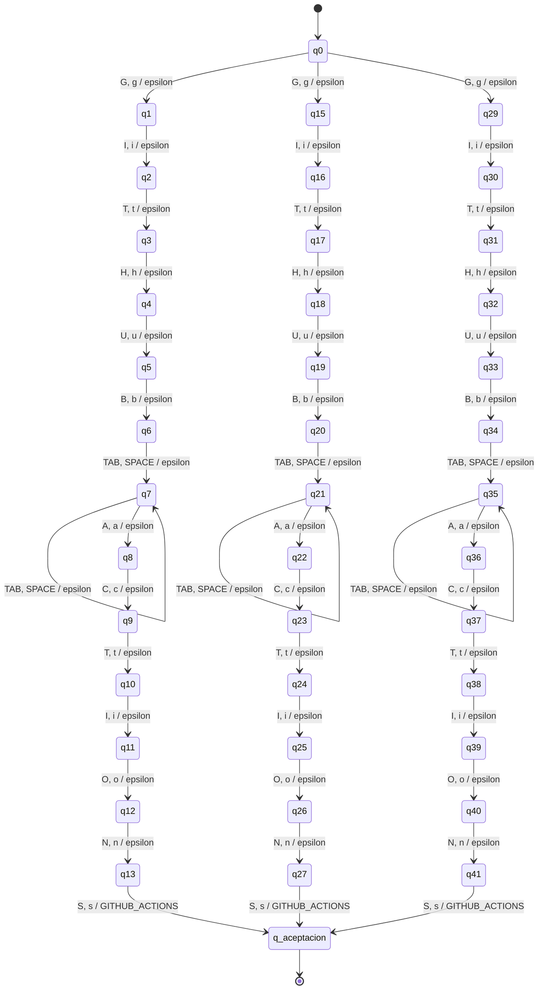

## GITLAB_CI

Aliases: `GitLab CI`, `Gitlab CI`, `gitlab ci`

- Q = {q0, q1, q10, q11, q12, q13, q14, q15, q16, q17, q19, q2, q20, q21, q22, q23, q24, q25, q26, q3, q4, q5, q6, q7, q8, q_aceptacion}
- Sigma = {'\t', ' ', 'A', 'B', 'C', 'G', 'I', 'L', 'T', 'a', 'b', 'c', 'g', 'i', 'l', 't'}
- Gamma = {A, B, C, G, I, L, T, _}
- Initial state: q0
- F = {q_aceptacion}

| Source | Input alternatives | Destination | Output word |
|---|---|---|---|
| q0 | `G, g` | q1 | epsilon |
| q0 | `G, g` | q10 | epsilon |
| q0 | `G, g` | q19 | epsilon |
| q1 | `I, i` | q2 | epsilon |
| q10 | `I, i` | q11 | epsilon |
| q11 | `T, t` | q12 | epsilon |
| q12 | `L, l` | q13 | epsilon |
| q13 | `A, a` | q14 | epsilon |
| q14 | `B, b` | q15 | epsilon |
| q15 | `TAB, SPACE` | q16 | epsilon |
| q16 | `TAB, SPACE` | q16 | epsilon |
| q16 | `C, c` | q17 | epsilon |
| q17 | `I, i` | q_aceptacion | GITLAB_CI |
| q19 | `I, i` | q20 | epsilon |
| q2 | `T, t` | q3 | epsilon |
| q20 | `T, t` | q21 | epsilon |
| q21 | `L, l` | q22 | epsilon |
| q22 | `A, a` | q23 | epsilon |
| q23 | `B, b` | q24 | epsilon |
| q24 | `TAB, SPACE` | q25 | epsilon |
| q25 | `TAB, SPACE` | q25 | epsilon |
| q25 | `C, c` | q26 | epsilon |
| q26 | `I, i` | q_aceptacion | GITLAB_CI |
| q3 | `L, l` | q4 | epsilon |
| q4 | `A, a` | q5 | epsilon |
| q5 | `B, b` | q6 | epsilon |
| q6 | `TAB, SPACE` | q7 | epsilon |
| q7 | `TAB, SPACE` | q7 | epsilon |
| q7 | `C, c` | q8 | epsilon |
| q8 | `I, i` | q_aceptacion | GITLAB_CI |

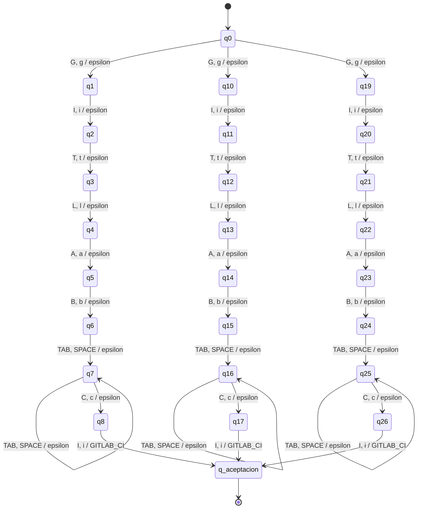

## JAVA

Aliases: `Java`

- Q = {q0, q1, q2, q3, q_aceptacion}
- Sigma = {'A', 'J', 'V', 'a', 'j', 'v'}
- Gamma = {A, J, V}
- Initial state: q0
- F = {q_aceptacion}

| Source | Input alternatives | Destination | Output word |
|---|---|---|---|
| q0 | `J, j` | q1 | epsilon |
| q1 | `A, a` | q2 | epsilon |
| q2 | `V, v` | q3 | epsilon |
| q3 | `A, a` | q_aceptacion | JAVA |

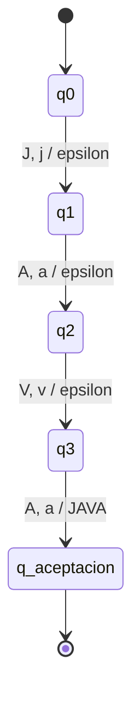

## JAVASCRIPT

Aliases: `JS`, `Javascript`, `JavaScript`

- Q = {q0, q1, q10, q11, q13, q14, q15, q16, q17, q18, q19, q20, q21, q3, q4, q5, q6, q7, q8, q9, q_aceptacion}
- Sigma = {'A', 'C', 'I', 'J', 'P', 'R', 'S', 'T', 'V', 'a', 'c', 'i', 'j', 'p', 'r', 's', 't', 'v'}
- Gamma = {A, C, I, J, P, R, S, T, V}
- Initial state: q0
- F = {q_aceptacion}

| Source | Input alternatives | Destination | Output word |
|---|---|---|---|
| q0 | `J, j` | q1 | epsilon |
| q0 | `J, j` | q13 | epsilon |
| q0 | `J, j` | q3 | epsilon |
| q1 | `S, s` | q_aceptacion | JAVASCRIPT |
| q10 | `P, p` | q11 | epsilon |
| q11 | `T, t` | q_aceptacion | JAVASCRIPT |
| q13 | `A, a` | q14 | epsilon |
| q14 | `V, v` | q15 | epsilon |
| q15 | `A, a` | q16 | epsilon |
| q16 | `S, s` | q17 | epsilon |
| q17 | `C, c` | q18 | epsilon |
| q18 | `R, r` | q19 | epsilon |
| q19 | `I, i` | q20 | epsilon |
| q20 | `P, p` | q21 | epsilon |
| q21 | `T, t` | q_aceptacion | JAVASCRIPT |
| q3 | `A, a` | q4 | epsilon |
| q4 | `V, v` | q5 | epsilon |
| q5 | `A, a` | q6 | epsilon |
| q6 | `S, s` | q7 | epsilon |
| q7 | `C, c` | q8 | epsilon |
| q8 | `R, r` | q9 | epsilon |
| q9 | `I, i` | q10 | epsilon |

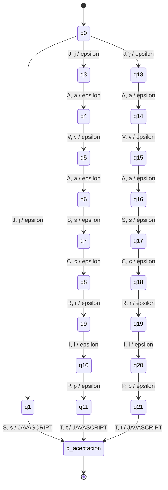

## JENKINS

Aliases: `Jenkins`, `jenkins`, `JENKINS`

- Q = {q0, q1, q10, q11, q12, q13, q15, q16, q17, q18, q19, q2, q20, q3, q4, q5, q6, q8, q9, q_aceptacion}
- Sigma = {'E', 'I', 'J', 'K', 'N', 'S', 'e', 'i', 'j', 'k', 'n', 's'}
- Gamma = {E, I, J, K, N, S}
- Initial state: q0
- F = {q_aceptacion}

| Source | Input alternatives | Destination | Output word |
|---|---|---|---|
| q0 | `J, j` | q1 | epsilon |
| q0 | `J, j` | q15 | epsilon |
| q0 | `J, j` | q8 | epsilon |
| q1 | `E, e` | q2 | epsilon |
| q10 | `K, k` | q11 | epsilon |
| q11 | `I, i` | q12 | epsilon |
| q12 | `N, n` | q13 | epsilon |
| q13 | `S, s` | q_aceptacion | JENKINS |
| q15 | `E, e` | q16 | epsilon |
| q16 | `N, n` | q17 | epsilon |
| q17 | `K, k` | q18 | epsilon |
| q18 | `I, i` | q19 | epsilon |
| q19 | `N, n` | q20 | epsilon |
| q2 | `N, n` | q3 | epsilon |
| q20 | `S, s` | q_aceptacion | JENKINS |
| q3 | `K, k` | q4 | epsilon |
| q4 | `I, i` | q5 | epsilon |
| q5 | `N, n` | q6 | epsilon |
| q6 | `S, s` | q_aceptacion | JENKINS |
| q8 | `E, e` | q9 | epsilon |
| q9 | `N, n` | q10 | epsilon |

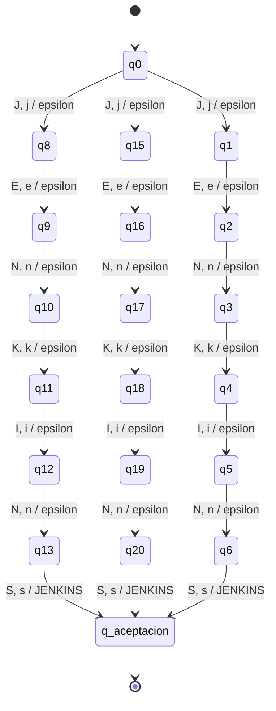

## KAFKA

Aliases: `Kafka`, `kafka`, `Apache Kafka`

- Q = {q0, q1, q11, q12, q13, q14, q15, q16, q17, q18, q19, q2, q20, q21, q3, q4, q6, q7, q8, q9, q_aceptacion}
- Sigma = {'\t', ' ', 'A', 'C', 'E', 'F', 'H', 'K', 'P', 'a', 'c', 'e', 'f', 'h', 'k', 'p'}
- Gamma = {A, F, K}
- Initial state: q0
- F = {q_aceptacion}

| Source | Input alternatives | Destination | Output word |
|---|---|---|---|
| q0 | `K, k` | q1 | epsilon |
| q0 | `A, a` | q11 | epsilon |
| q0 | `K, k` | q6 | epsilon |
| q1 | `A, a` | q2 | epsilon |
| q11 | `P, p` | q12 | epsilon |
| q12 | `A, a` | q13 | epsilon |
| q13 | `C, c` | q14 | epsilon |
| q14 | `H, h` | q15 | epsilon |
| q15 | `E, e` | q16 | epsilon |
| q16 | `TAB, SPACE` | q17 | epsilon |
| q17 | `TAB, SPACE` | q17 | epsilon |
| q17 | `K, k` | q18 | epsilon |
| q18 | `A, a` | q19 | epsilon |
| q19 | `F, f` | q20 | epsilon |
| q2 | `F, f` | q3 | epsilon |
| q20 | `K, k` | q21 | epsilon |
| q21 | `A, a` | q_aceptacion | KAFKA |
| q3 | `K, k` | q4 | epsilon |
| q4 | `A, a` | q_aceptacion | KAFKA |
| q6 | `A, a` | q7 | epsilon |
| q7 | `F, f` | q8 | epsilon |
| q8 | `K, k` | q9 | epsilon |
| q9 | `A, a` | q_aceptacion | KAFKA |

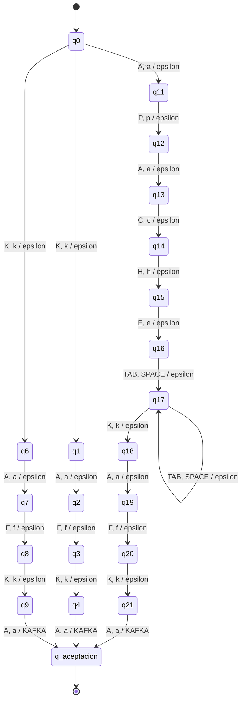

## KUBERNETES

Aliases: `Kubernetes`, `kubernetes`, `K8s`, `k8s`

- Q = {q0, q1, q11, q12, q13, q14, q15, q16, q17, q18, q19, q2, q21, q22, q24, q25, q3, q4, q5, q6, q7, q8, q9, q_aceptacion}
- Sigma = {'8', 'B', 'E', 'K', 'N', 'R', 'S', 'T', 'U', 'b', 'e', 'k', 'n', 'r', 's', 't', 'u'}
- Gamma = {B, E, K, N, R, S, T, U}
- Initial state: q0
- F = {q_aceptacion}

| Source | Input alternatives | Destination | Output word |
|---|---|---|---|
| q0 | `K, k` | q1 | epsilon |
| q0 | `K, k` | q11 | epsilon |
| q0 | `K, k` | q21 | epsilon |
| q0 | `K, k` | q24 | epsilon |
| q1 | `U, u` | q2 | epsilon |
| q11 | `U, u` | q12 | epsilon |
| q12 | `B, b` | q13 | epsilon |
| q13 | `E, e` | q14 | epsilon |
| q14 | `R, r` | q15 | epsilon |
| q15 | `N, n` | q16 | epsilon |
| q16 | `E, e` | q17 | epsilon |
| q17 | `T, t` | q18 | epsilon |
| q18 | `E, e` | q19 | epsilon |
| q19 | `S, s` | q_aceptacion | KUBERNETES |
| q2 | `B, b` | q3 | epsilon |
| q21 | `8` | q22 | epsilon |
| q22 | `S, s` | q_aceptacion | KUBERNETES |
| q24 | `8` | q25 | epsilon |
| q25 | `S, s` | q_aceptacion | KUBERNETES |
| q3 | `E, e` | q4 | epsilon |
| q4 | `R, r` | q5 | epsilon |
| q5 | `N, n` | q6 | epsilon |
| q6 | `E, e` | q7 | epsilon |
| q7 | `T, t` | q8 | epsilon |
| q8 | `E, e` | q9 | epsilon |
| q9 | `S, s` | q_aceptacion | KUBERNETES |

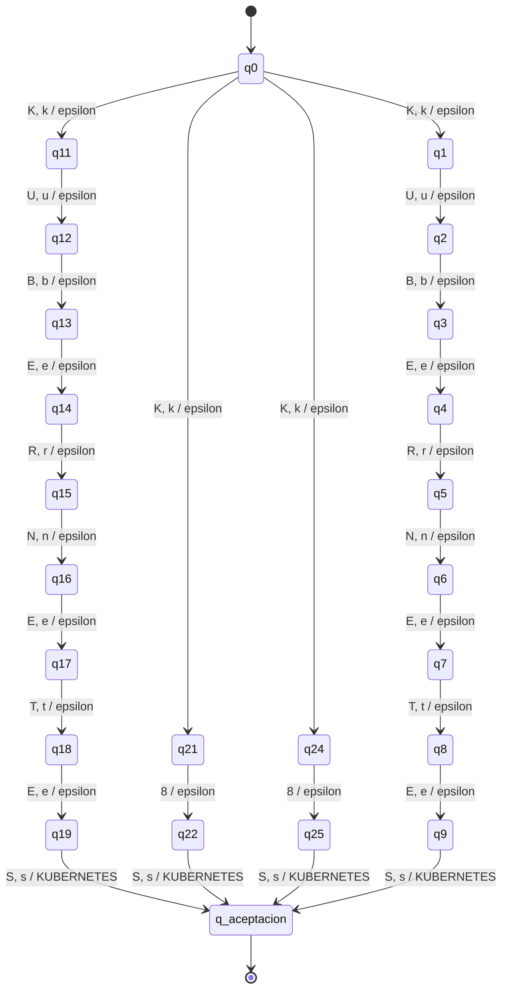

## LINUX

Aliases: `Linux`, `linux`

- Q = {q0, q1, q2, q3, q4, q6, q7, q8, q9, q_aceptacion}
- Sigma = {'I', 'L', 'N', 'U', 'X', 'i', 'l', 'n', 'u', 'x'}
- Gamma = {I, L, N, U, X}
- Initial state: q0
- F = {q_aceptacion}

| Source | Input alternatives | Destination | Output word |
|---|---|---|---|
| q0 | `L, l` | q1 | epsilon |
| q0 | `L, l` | q6 | epsilon |
| q1 | `I, i` | q2 | epsilon |
| q2 | `N, n` | q3 | epsilon |
| q3 | `U, u` | q4 | epsilon |
| q4 | `X, x` | q_aceptacion | LINUX |
| q6 | `I, i` | q7 | epsilon |
| q7 | `N, n` | q8 | epsilon |
| q8 | `U, u` | q9 | epsilon |
| q9 | `X, x` | q_aceptacion | LINUX |

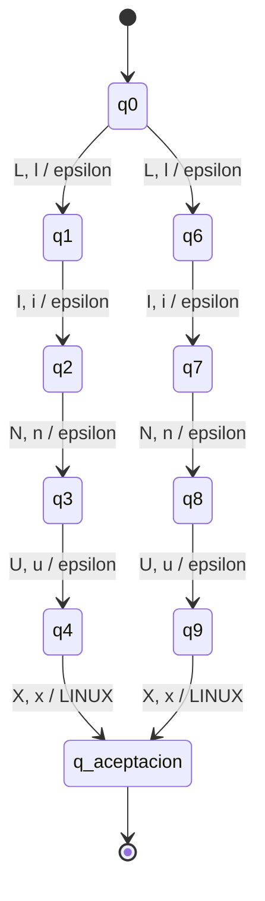

## MACHINE_LEARNING

Aliases: `machine learning model development`, `machine-learning model development`, `ML`, `Machine Learning`, `Machine-learning`, `machine learning`

- Q = {q0, q1, q10, q100, q101, q103, q104, q105, q106, q107, q108, q109, q11, q110, q111, q112, q113, q114, q115, q116, q117, q12, q13, q14, q15, q16, q17, q18, q19, q2, q20, q21, q22, q23, q24, q25, q26, q27, q28, q29, q3, q30, q31, q32, q33, q35, q36, q37, q38, q39, q4, q40, q41, q42, q43, q44, q45, q46, q47, q48, q49, q5, q50, q51, q52, q53, q54, q55, q56, q57, q58, q59, q6, q60, q61, q62, q63, q64, q65, q66, q67, q69, q7, q71, q72, q73, q74, q75, q76, q77, q78, q79, q8, q80, q81, q82, q83, q84, q85, q87, q88, q89, q9, q90, q91, q92, q93, q94, q95, q96, q97, q98, q99, q_aceptacion}
- Sigma = {'\t', ' ', '-', 'A', 'C', 'D', 'E', 'G', 'H', 'I', 'L', 'M', 'N', 'O', 'P', 'R', 'T', 'V', 'a', 'c', 'd', 'e', 'g', 'h', 'i', 'l', 'm', 'n', 'o', 'p', 'r', 't', 'v'}
- Gamma = {A, C, E, G, H, I, L, M, N, R, _}
- Initial state: q0
- F = {q_aceptacion}

| Source | Input alternatives | Destination | Output word |
|---|---|---|---|
| q0 | `M, m` | q1 | epsilon |
| q0 | `M, m` | q103 | epsilon |
| q0 | `M, m` | q35 | epsilon |
| q0 | `M, m` | q69 | epsilon |
| q0 | `M, m` | q71 | epsilon |
| q0 | `M, m` | q87 | epsilon |
| q1 | `A, a` | q2 | epsilon |
| q10 | `A, a` | q11 | epsilon |
| q100 | `N, n` | q101 | epsilon |
| q101 | `G, g` | q_aceptacion | MACHINE_LEARNING |
| q103 | `A, a` | q104 | epsilon |
| q104 | `C, c` | q105 | epsilon |
| q105 | `H, h` | q106 | epsilon |
| q106 | `I, i` | q107 | epsilon |
| q107 | `N, n` | q108 | epsilon |
| q108 | `E, e` | q109 | epsilon |
| q109 | `TAB, SPACE` | q110 | epsilon |
| q11 | `R, r` | q12 | epsilon |
| q110 | `TAB, SPACE` | q110 | epsilon |
| q110 | `L, l` | q111 | epsilon |
| q111 | `E, e` | q112 | epsilon |
| q112 | `A, a` | q113 | epsilon |
| q113 | `R, r` | q114 | epsilon |
| q114 | `N, n` | q115 | epsilon |
| q115 | `I, i` | q116 | epsilon |
| q116 | `N, n` | q117 | epsilon |
| q117 | `G, g` | q_aceptacion | MACHINE_LEARNING |
| q12 | `N, n` | q13 | epsilon |
| q13 | `I, i` | q14 | epsilon |
| q14 | `N, n` | q15 | epsilon |
| q15 | `G, g` | q16 | epsilon |
| q16 | `TAB, SPACE` | q17 | epsilon |
| q17 | `TAB, SPACE` | q17 | epsilon |
| q17 | `M, m` | q18 | epsilon |
| q18 | `O, o` | q19 | epsilon |
| q19 | `D, d` | q20 | epsilon |
| q2 | `C, c` | q3 | epsilon |
| q20 | `E, e` | q21 | epsilon |
| q21 | `L, l` | q22 | epsilon |
| q22 | `TAB, SPACE` | q23 | epsilon |
| q23 | `TAB, SPACE` | q23 | epsilon |
| q23 | `D, d` | q24 | epsilon |
| q24 | `E, e` | q25 | epsilon |
| q25 | `V, v` | q26 | epsilon |
| q26 | `E, e` | q27 | epsilon |
| q27 | `L, l` | q28 | epsilon |
| q28 | `O, o` | q29 | epsilon |
| q29 | `P, p` | q30 | epsilon |
| q3 | `H, h` | q4 | epsilon |
| q30 | `M, m` | q31 | epsilon |
| q31 | `E, e` | q32 | epsilon |
| q32 | `N, n` | q33 | epsilon |
| q33 | `T, t` | q_aceptacion | MACHINE_LEARNING |
| q35 | `A, a` | q36 | epsilon |
| q36 | `C, c` | q37 | epsilon |
| q37 | `H, h` | q38 | epsilon |
| q38 | `I, i` | q39 | epsilon |
| q39 | `N, n` | q40 | epsilon |
| q4 | `I, i` | q5 | epsilon |
| q40 | `E, e` | q41 | epsilon |
| q41 | `-` | q42 | epsilon |
| q42 | `L, l` | q43 | epsilon |
| q43 | `E, e` | q44 | epsilon |
| q44 | `A, a` | q45 | epsilon |
| q45 | `R, r` | q46 | epsilon |
| q46 | `N, n` | q47 | epsilon |
| q47 | `I, i` | q48 | epsilon |
| q48 | `N, n` | q49 | epsilon |
| q49 | `G, g` | q50 | epsilon |
| q5 | `N, n` | q6 | epsilon |
| q50 | `TAB, SPACE` | q51 | epsilon |
| q51 | `TAB, SPACE` | q51 | epsilon |
| q51 | `M, m` | q52 | epsilon |
| q52 | `O, o` | q53 | epsilon |
| q53 | `D, d` | q54 | epsilon |
| q54 | `E, e` | q55 | epsilon |
| q55 | `L, l` | q56 | epsilon |
| q56 | `TAB, SPACE` | q57 | epsilon |
| q57 | `TAB, SPACE` | q57 | epsilon |
| q57 | `D, d` | q58 | epsilon |
| q58 | `E, e` | q59 | epsilon |
| q59 | `V, v` | q60 | epsilon |
| q6 | `E, e` | q7 | epsilon |
| q60 | `E, e` | q61 | epsilon |
| q61 | `L, l` | q62 | epsilon |
| q62 | `O, o` | q63 | epsilon |
| q63 | `P, p` | q64 | epsilon |
| q64 | `M, m` | q65 | epsilon |
| q65 | `E, e` | q66 | epsilon |
| q66 | `N, n` | q67 | epsilon |
| q67 | `T, t` | q_aceptacion | MACHINE_LEARNING |
| q69 | `L, l` | q_aceptacion | MACHINE_LEARNING |
| q7 | `TAB, SPACE` | q8 | epsilon |
| q71 | `A, a` | q72 | epsilon |
| q72 | `C, c` | q73 | epsilon |
| q73 | `H, h` | q74 | epsilon |
| q74 | `I, i` | q75 | epsilon |
| q75 | `N, n` | q76 | epsilon |
| q76 | `E, e` | q77 | epsilon |
| q77 | `TAB, SPACE` | q78 | epsilon |
| q78 | `TAB, SPACE` | q78 | epsilon |
| q78 | `L, l` | q79 | epsilon |
| q79 | `E, e` | q80 | epsilon |
| q8 | `TAB, SPACE` | q8 | epsilon |
| q8 | `L, l` | q9 | epsilon |
| q80 | `A, a` | q81 | epsilon |
| q81 | `R, r` | q82 | epsilon |
| q82 | `N, n` | q83 | epsilon |
| q83 | `I, i` | q84 | epsilon |
| q84 | `N, n` | q85 | epsilon |
| q85 | `G, g` | q_aceptacion | MACHINE_LEARNING |
| q87 | `A, a` | q88 | epsilon |
| q88 | `C, c` | q89 | epsilon |
| q89 | `H, h` | q90 | epsilon |
| q9 | `E, e` | q10 | epsilon |
| q90 | `I, i` | q91 | epsilon |
| q91 | `N, n` | q92 | epsilon |
| q92 | `E, e` | q93 | epsilon |
| q93 | `-` | q94 | epsilon |
| q94 | `L, l` | q95 | epsilon |
| q95 | `E, e` | q96 | epsilon |
| q96 | `A, a` | q97 | epsilon |
| q97 | `R, r` | q98 | epsilon |
| q98 | `N, n` | q99 | epsilon |
| q99 | `I, i` | q100 | epsilon |

```mermaid
stateDiagram-v2
    [*] --> q0
    q_aceptacion --> [*]
    q0 --> q1: M, m / epsilon
    q0 --> q103: M, m / epsilon
    q0 --> q35: M, m / epsilon
    q0 --> q69: M, m / epsilon
    q0 --> q71: M, m / epsilon
    q0 --> q87: M, m / epsilon
    q1 --> q2: A, a / epsilon
    q10 --> q11: A, a / epsilon
    q100 --> q101: N, n / epsilon
    q101 --> q_aceptacion: G, g / MACHINE_LEARNING
    q103 --> q104: A, a / epsilon
    q104 --> q105: C, c / epsilon
    q105 --> q106: H, h / epsilon
    q106 --> q107: I, i / epsilon
    q107 --> q108: N, n / epsilon
    q108 --> q109: E, e / epsilon
    q109 --> q110: TAB, SPACE / epsilon
    q11 --> q12: R, r / epsilon
    q110 --> q110: TAB, SPACE / epsilon
    q110 --> q111: L, l / epsilon
    q111 --> q112: E, e / epsilon
    q112 --> q113: A, a / epsilon
    q113 --> q114: R, r / epsilon
    q114 --> q115: N, n / epsilon
    q115 --> q116: I, i / epsilon
    q116 --> q117: N, n / epsilon
    q117 --> q_aceptacion: G, g / MACHINE_LEARNING
    q12 --> q13: N, n / epsilon
    q13 --> q14: I, i / epsilon
    q14 --> q15: N, n / epsilon
    q15 --> q16: G, g / epsilon
    q16 --> q17: TAB, SPACE / epsilon
    q17 --> q17: TAB, SPACE / epsilon
    q17 --> q18: M, m / epsilon
    q18 --> q19: O, o / epsilon
    q19 --> q20: D, d / epsilon
    q2 --> q3: C, c / epsilon
    q20 --> q21: E, e / epsilon
    q21 --> q22: L, l / epsilon
    q22 --> q23: TAB, SPACE / epsilon
    q23 --> q23: TAB, SPACE / epsilon
    q23 --> q24: D, d / epsilon
    q24 --> q25: E, e / epsilon
    q25 --> q26: V, v / epsilon
    q26 --> q27: E, e / epsilon
    q27 --> q28: L, l / epsilon
    q28 --> q29: O, o / epsilon
    q29 --> q30: P, p / epsilon
    q3 --> q4: H, h / epsilon
    q30 --> q31: M, m / epsilon
    q31 --> q32: E, e / epsilon
    q32 --> q33: N, n / epsilon
    q33 --> q_aceptacion: T, t / MACHINE_LEARNING
    q35 --> q36: A, a / epsilon
    q36 --> q37: C, c / epsilon
    q37 --> q38: H, h / epsilon
    q38 --> q39: I, i / epsilon
    q39 --> q40: N, n / epsilon
    q4 --> q5: I, i / epsilon
    q40 --> q41: E, e / epsilon
    q41 --> q42: - / epsilon
    q42 --> q43: L, l / epsilon
    q43 --> q44: E, e / epsilon
    q44 --> q45: A, a / epsilon
    q45 --> q46: R, r / epsilon
    q46 --> q47: N, n / epsilon
    q47 --> q48: I, i / epsilon
    q48 --> q49: N, n / epsilon
    q49 --> q50: G, g / epsilon
    q5 --> q6: N, n / epsilon
    q50 --> q51: TAB, SPACE / epsilon
    q51 --> q51: TAB, SPACE / epsilon
    q51 --> q52: M, m / epsilon
    q52 --> q53: O, o / epsilon
    q53 --> q54: D, d / epsilon
    q54 --> q55: E, e / epsilon
    q55 --> q56: L, l / epsilon
    q56 --> q57: TAB, SPACE / epsilon
    q57 --> q57: TAB, SPACE / epsilon
    q57 --> q58: D, d / epsilon
    q58 --> q59: E, e / epsilon
    q59 --> q60: V, v / epsilon
    q6 --> q7: E, e / epsilon
    q60 --> q61: E, e / epsilon
    q61 --> q62: L, l / epsilon
    q62 --> q63: O, o / epsilon
    q63 --> q64: P, p / epsilon
    q64 --> q65: M, m / epsilon
    q65 --> q66: E, e / epsilon
    q66 --> q67: N, n / epsilon
    q67 --> q_aceptacion: T, t / MACHINE_LEARNING
    q69 --> q_aceptacion: L, l / MACHINE_LEARNING
    q7 --> q8: TAB, SPACE / epsilon
    q71 --> q72: A, a / epsilon
    q72 --> q73: C, c / epsilon
    q73 --> q74: H, h / epsilon
    q74 --> q75: I, i / epsilon
    q75 --> q76: N, n / epsilon
    q76 --> q77: E, e / epsilon
    q77 --> q78: TAB, SPACE / epsilon
    q78 --> q78: TAB, SPACE / epsilon
    q78 --> q79: L, l / epsilon
    q79 --> q80: E, e / epsilon
    q8 --> q8: TAB, SPACE / epsilon
    q8 --> q9: L, l / epsilon
    q80 --> q81: A, a / epsilon
    q81 --> q82: R, r / epsilon
    q82 --> q83: N, n / epsilon
    q83 --> q84: I, i / epsilon
    q84 --> q85: N, n / epsilon
    q85 --> q_aceptacion: G, g / MACHINE_LEARNING
    q87 --> q88: A, a / epsilon
    q88 --> q89: C, c / epsilon
    q89 --> q90: H, h / epsilon
    q9 --> q10: E, e / epsilon
    q90 --> q91: I, i / epsilon
    q91 --> q92: N, n / epsilon
    q92 --> q93: E, e / epsilon
    q93 --> q94: - / epsilon
    q94 --> q95: L, l / epsilon
    q95 --> q96: E, e / epsilon
    q96 --> q97: A, a / epsilon
    q97 --> q98: R, r / epsilon
    q98 --> q99: N, n / epsilon
    q99 --> q100: I, i / epsilon
```

## MONGODB

Aliases: `MongoDB`

- Q = {q0, q1, q2, q3, q4, q5, q6, q_aceptacion}
- Sigma = {'B', 'D', 'G', 'M', 'N', 'O', 'b', 'd', 'g', 'm', 'n', 'o'}
- Gamma = {B, D, G, M, N, O}
- Initial state: q0
- F = {q_aceptacion}

| Source | Input alternatives | Destination | Output word |
|---|---|---|---|
| q0 | `M, m` | q1 | epsilon |
| q1 | `O, o` | q2 | epsilon |
| q2 | `N, n` | q3 | epsilon |
| q3 | `G, g` | q4 | epsilon |
| q4 | `O, o` | q5 | epsilon |
| q5 | `D, d` | q6 | epsilon |
| q6 | `B, b` | q_aceptacion | MONGODB |

```mermaid
stateDiagram-v2
    [*] --> q0
    q_aceptacion --> [*]
    q0 --> q1: M, m / epsilon
    q1 --> q2: O, o / epsilon
    q2 --> q3: N, n / epsilon
    q3 --> q4: G, g / epsilon
    q4 --> q5: O, o / epsilon
    q5 --> q6: D, d / epsilon
    q6 --> q_aceptacion: B, b / MONGODB
```

## MYSQL

Aliases: `MySQL`

- Q = {q0, q1, q2, q3, q4, q_aceptacion}
- Sigma = {'L', 'M', 'Q', 'S', 'Y', 'l', 'm', 'q', 's', 'y'}
- Gamma = {L, M, Q, S, Y}
- Initial state: q0
- F = {q_aceptacion}

| Source | Input alternatives | Destination | Output word |
|---|---|---|---|
| q0 | `M, m` | q1 | epsilon |
| q1 | `Y, y` | q2 | epsilon |
| q2 | `S, s` | q3 | epsilon |
| q3 | `Q, q` | q4 | epsilon |
| q4 | `L, l` | q_aceptacion | MYSQL |

```mermaid
stateDiagram-v2
    [*] --> q0
    q_aceptacion --> [*]
    q0 --> q1: M, m / epsilon
    q1 --> q2: Y, y / epsilon
    q2 --> q3: S, s / epsilon
    q3 --> q4: Q, q / epsilon
    q4 --> q_aceptacion: L, l / MYSQL
```

## NODE_JS

Aliases: `NodeJS`, `Node.js`, `node`, `Node`

- Q = {q0, q1, q10, q11, q12, q14, q15, q16, q18, q19, q2, q20, q3, q4, q5, q7, q8, q9, q_aceptacion}
- Sigma = {'.', 'D', 'E', 'J', 'N', 'O', 'S', 'd', 'e', 'j', 'n', 'o', 's'}
- Gamma = {D, E, J, N, O, S, _}
- Initial state: q0
- F = {q_aceptacion}

| Source | Input alternatives | Destination | Output word |
|---|---|---|---|
| q0 | `N, n` | q1 | epsilon |
| q0 | `N, n` | q14 | epsilon |
| q0 | `N, n` | q18 | epsilon |
| q0 | `N, n` | q7 | epsilon |
| q1 | `O, o` | q2 | epsilon |
| q10 | `.` | q11 | epsilon |
| q11 | `J, j` | q12 | epsilon |
| q12 | `S, s` | q_aceptacion | NODE_JS |
| q14 | `O, o` | q15 | epsilon |
| q15 | `D, d` | q16 | epsilon |
| q16 | `E, e` | q_aceptacion | NODE_JS |
| q18 | `O, o` | q19 | epsilon |
| q19 | `D, d` | q20 | epsilon |
| q2 | `D, d` | q3 | epsilon |
| q20 | `E, e` | q_aceptacion | NODE_JS |
| q3 | `E, e` | q4 | epsilon |
| q4 | `J, j` | q5 | epsilon |
| q5 | `S, s` | q_aceptacion | NODE_JS |
| q7 | `O, o` | q8 | epsilon |
| q8 | `D, d` | q9 | epsilon |
| q9 | `E, e` | q10 | epsilon |

```mermaid
stateDiagram-v2
    [*] --> q0
    q_aceptacion --> [*]
    q0 --> q1: N, n / epsilon
    q0 --> q14: N, n / epsilon
    q0 --> q18: N, n / epsilon
    q0 --> q7: N, n / epsilon
    q1 --> q2: O, o / epsilon
    q10 --> q11: . / epsilon
    q11 --> q12: J, j / epsilon
    q12 --> q_aceptacion: S, s / NODE_JS
    q14 --> q15: O, o / epsilon
    q15 --> q16: D, d / epsilon
    q16 --> q_aceptacion: E, e / NODE_JS
    q18 --> q19: O, o / epsilon
    q19 --> q20: D, d / epsilon
    q2 --> q3: D, d / epsilon
    q20 --> q_aceptacion: E, e / NODE_JS
    q3 --> q4: E, e / epsilon
    q4 --> q5: J, j / epsilon
    q5 --> q_aceptacion: S, s / NODE_JS
    q7 --> q8: O, o / epsilon
    q8 --> q9: D, d / epsilon
    q9 --> q10: E, e / epsilon
```

## NOSQL

Aliases: `NoSQL`, `nosql`, `No SQL`

- Q = {q0, q1, q11, q12, q13, q14, q15, q2, q3, q4, q6, q7, q8, q9, q_aceptacion}
- Sigma = {'\t', ' ', 'L', 'N', 'O', 'Q', 'S', 'l', 'n', 'o', 'q', 's'}
- Gamma = {L, N, O, Q, S}
- Initial state: q0
- F = {q_aceptacion}

| Source | Input alternatives | Destination | Output word |
|---|---|---|---|
| q0 | `N, n` | q1 | epsilon |
| q0 | `N, n` | q11 | epsilon |
| q0 | `N, n` | q6 | epsilon |
| q1 | `O, o` | q2 | epsilon |
| q11 | `O, o` | q12 | epsilon |
| q12 | `TAB, SPACE` | q13 | epsilon |
| q13 | `TAB, SPACE` | q13 | epsilon |
| q13 | `S, s` | q14 | epsilon |
| q14 | `Q, q` | q15 | epsilon |
| q15 | `L, l` | q_aceptacion | NOSQL |
| q2 | `S, s` | q3 | epsilon |
| q3 | `Q, q` | q4 | epsilon |
| q4 | `L, l` | q_aceptacion | NOSQL |
| q6 | `O, o` | q7 | epsilon |
| q7 | `S, s` | q8 | epsilon |
| q8 | `Q, q` | q9 | epsilon |
| q9 | `L, l` | q_aceptacion | NOSQL |

```mermaid
stateDiagram-v2
    [*] --> q0
    q_aceptacion --> [*]
    q0 --> q1: N, n / epsilon
    q0 --> q11: N, n / epsilon
    q0 --> q6: N, n / epsilon
    q1 --> q2: O, o / epsilon
    q11 --> q12: O, o / epsilon
    q12 --> q13: TAB, SPACE / epsilon
    q13 --> q13: TAB, SPACE / epsilon
    q13 --> q14: S, s / epsilon
    q14 --> q15: Q, q / epsilon
    q15 --> q_aceptacion: L, l / NOSQL
    q2 --> q3: S, s / epsilon
    q3 --> q4: Q, q / epsilon
    q4 --> q_aceptacion: L, l / NOSQL
    q6 --> q7: O, o / epsilon
    q7 --> q8: S, s / epsilon
    q8 --> q9: Q, q / epsilon
    q9 --> q_aceptacion: L, l / NOSQL
```

## NUMPY

Aliases: `numpy`, `NumPy`, `Numpy`

- Q = {q0, q1, q11, q12, q13, q14, q2, q3, q4, q6, q7, q8, q9, q_aceptacion}
- Sigma = {'M', 'N', 'P', 'U', 'Y', 'm', 'n', 'p', 'u', 'y'}
- Gamma = {M, N, P, U, Y}
- Initial state: q0
- F = {q_aceptacion}

| Source | Input alternatives | Destination | Output word |
|---|---|---|---|
| q0 | `N, n` | q1 | epsilon |
| q0 | `N, n` | q11 | epsilon |
| q0 | `N, n` | q6 | epsilon |
| q1 | `U, u` | q2 | epsilon |
| q11 | `U, u` | q12 | epsilon |
| q12 | `M, m` | q13 | epsilon |
| q13 | `P, p` | q14 | epsilon |
| q14 | `Y, y` | q_aceptacion | NUMPY |
| q2 | `M, m` | q3 | epsilon |
| q3 | `P, p` | q4 | epsilon |
| q4 | `Y, y` | q_aceptacion | NUMPY |
| q6 | `U, u` | q7 | epsilon |
| q7 | `M, m` | q8 | epsilon |
| q8 | `P, p` | q9 | epsilon |
| q9 | `Y, y` | q_aceptacion | NUMPY |

```mermaid
stateDiagram-v2
    [*] --> q0
    q_aceptacion --> [*]
    q0 --> q1: N, n / epsilon
    q0 --> q11: N, n / epsilon
    q0 --> q6: N, n / epsilon
    q1 --> q2: U, u / epsilon
    q11 --> q12: U, u / epsilon
    q12 --> q13: M, m / epsilon
    q13 --> q14: P, p / epsilon
    q14 --> q_aceptacion: Y, y / NUMPY
    q2 --> q3: M, m / epsilon
    q3 --> q4: P, p / epsilon
    q4 --> q_aceptacion: Y, y / NUMPY
    q6 --> q7: U, u / epsilon
    q7 --> q8: M, m / epsilon
    q8 --> q9: P, p / epsilon
    q9 --> q_aceptacion: Y, y / NUMPY
```

## PANDAS

Aliases: `pandas`, `Pandas`

- Q = {q0, q1, q10, q11, q2, q3, q4, q5, q7, q8, q9, q_aceptacion}
- Sigma = {'A', 'D', 'N', 'P', 'S', 'a', 'd', 'n', 'p', 's'}
- Gamma = {A, D, N, P, S}
- Initial state: q0
- F = {q_aceptacion}

| Source | Input alternatives | Destination | Output word |
|---|---|---|---|
| q0 | `P, p` | q1 | epsilon |
| q0 | `P, p` | q7 | epsilon |
| q1 | `A, a` | q2 | epsilon |
| q10 | `A, a` | q11 | epsilon |
| q11 | `S, s` | q_aceptacion | PANDAS |
| q2 | `N, n` | q3 | epsilon |
| q3 | `D, d` | q4 | epsilon |
| q4 | `A, a` | q5 | epsilon |
| q5 | `S, s` | q_aceptacion | PANDAS |
| q7 | `A, a` | q8 | epsilon |
| q8 | `N, n` | q9 | epsilon |
| q9 | `D, d` | q10 | epsilon |

```mermaid
stateDiagram-v2
    [*] --> q0
    q_aceptacion --> [*]
    q0 --> q1: P, p / epsilon
    q0 --> q7: P, p / epsilon
    q1 --> q2: A, a / epsilon
    q10 --> q11: A, a / epsilon
    q11 --> q_aceptacion: S, s / PANDAS
    q2 --> q3: N, n / epsilon
    q3 --> q4: D, d / epsilon
    q4 --> q5: A, a / epsilon
    q5 --> q_aceptacion: S, s / PANDAS
    q7 --> q8: A, a / epsilon
    q8 --> q9: N, n / epsilon
    q9 --> q10: D, d / epsilon
```

## POSTGRESQL

Aliases: `Postgres`, `PostgreSQL`, `postgresql`

- Q = {q0, q1, q10, q11, q12, q13, q14, q15, q16, q17, q19, q2, q20, q21, q22, q23, q24, q25, q26, q27, q3, q4, q5, q6, q7, q9, q_aceptacion}
- Sigma = {'E', 'G', 'L', 'O', 'P', 'Q', 'R', 'S', 'T', 'e', 'g', 'l', 'o', 'p', 'q', 'r', 's', 't'}
- Gamma = {E, G, L, O, P, Q, R, S, T}
- Initial state: q0
- F = {q_aceptacion}

| Source | Input alternatives | Destination | Output word |
|---|---|---|---|
| q0 | `P, p` | q1 | epsilon |
| q0 | `P, p` | q19 | epsilon |
| q0 | `P, p` | q9 | epsilon |
| q1 | `O, o` | q2 | epsilon |
| q10 | `S, s` | q11 | epsilon |
| q11 | `T, t` | q12 | epsilon |
| q12 | `G, g` | q13 | epsilon |
| q13 | `R, r` | q14 | epsilon |
| q14 | `E, e` | q15 | epsilon |
| q15 | `S, s` | q16 | epsilon |
| q16 | `Q, q` | q17 | epsilon |
| q17 | `L, l` | q_aceptacion | POSTGRESQL |
| q19 | `O, o` | q20 | epsilon |
| q2 | `S, s` | q3 | epsilon |
| q20 | `S, s` | q21 | epsilon |
| q21 | `T, t` | q22 | epsilon |
| q22 | `G, g` | q23 | epsilon |
| q23 | `R, r` | q24 | epsilon |
| q24 | `E, e` | q25 | epsilon |
| q25 | `S, s` | q26 | epsilon |
| q26 | `Q, q` | q27 | epsilon |
| q27 | `L, l` | q_aceptacion | POSTGRESQL |
| q3 | `T, t` | q4 | epsilon |
| q4 | `G, g` | q5 | epsilon |
| q5 | `R, r` | q6 | epsilon |
| q6 | `E, e` | q7 | epsilon |
| q7 | `S, s` | q_aceptacion | POSTGRESQL |
| q9 | `O, o` | q10 | epsilon |

```mermaid
stateDiagram-v2
    [*] --> q0
    q_aceptacion --> [*]
    q0 --> q1: P, p / epsilon
    q0 --> q19: P, p / epsilon
    q0 --> q9: P, p / epsilon
    q1 --> q2: O, o / epsilon
    q10 --> q11: S, s / epsilon
    q11 --> q12: T, t / epsilon
    q12 --> q13: G, g / epsilon
    q13 --> q14: R, r / epsilon
    q14 --> q15: E, e / epsilon
    q15 --> q16: S, s / epsilon
    q16 --> q17: Q, q / epsilon
    q17 --> q_aceptacion: L, l / POSTGRESQL
    q19 --> q20: O, o / epsilon
    q2 --> q3: S, s / epsilon
    q20 --> q21: S, s / epsilon
    q21 --> q22: T, t / epsilon
    q22 --> q23: G, g / epsilon
    q23 --> q24: R, r / epsilon
    q24 --> q25: E, e / epsilon
    q25 --> q26: S, s / epsilon
    q26 --> q27: Q, q / epsilon
    q27 --> q_aceptacion: L, l / POSTGRESQL
    q3 --> q4: T, t / epsilon
    q4 --> q5: G, g / epsilon
    q5 --> q6: R, r / epsilon
    q6 --> q7: E, e / epsilon
    q7 --> q_aceptacion: S, s / POSTGRESQL
    q9 --> q10: O, o / epsilon
```

## PYTHON

Aliases: `Python`, `python`, `py`

- Q = {q0, q1, q10, q11, q13, q2, q3, q4, q5, q7, q8, q9, q_aceptacion}
- Sigma = {'H', 'N', 'O', 'P', 'T', 'Y', 'h', 'n', 'o', 'p', 't', 'y'}
- Gamma = {H, N, O, P, T, Y}
- Initial state: q0
- F = {q_aceptacion}

| Source | Input alternatives | Destination | Output word |
|---|---|---|---|
| q0 | `P, p` | q1 | epsilon |
| q0 | `P, p` | q13 | epsilon |
| q0 | `P, p` | q7 | epsilon |
| q1 | `Y, y` | q2 | epsilon |
| q10 | `O, o` | q11 | epsilon |
| q11 | `N, n` | q_aceptacion | PYTHON |
| q13 | `Y, y` | q_aceptacion | PYTHON |
| q2 | `T, t` | q3 | epsilon |
| q3 | `H, h` | q4 | epsilon |
| q4 | `O, o` | q5 | epsilon |
| q5 | `N, n` | q_aceptacion | PYTHON |
| q7 | `Y, y` | q8 | epsilon |
| q8 | `T, t` | q9 | epsilon |
| q9 | `H, h` | q10 | epsilon |

```mermaid
stateDiagram-v2
    [*] --> q0
    q_aceptacion --> [*]
    q0 --> q1: P, p / epsilon
    q0 --> q13: P, p / epsilon
    q0 --> q7: P, p / epsilon
    q1 --> q2: Y, y / epsilon
    q10 --> q11: O, o / epsilon
    q11 --> q_aceptacion: N, n / PYTHON
    q13 --> q_aceptacion: Y, y / PYTHON
    q2 --> q3: T, t / epsilon
    q3 --> q4: H, h / epsilon
    q4 --> q5: O, o / epsilon
    q5 --> q_aceptacion: N, n / PYTHON
    q7 --> q8: Y, y / epsilon
    q8 --> q9: T, t / epsilon
    q9 --> q10: H, h / epsilon
```

## PYTORCH

Aliases: `Py Torch`, `PyTorch`, `pytorch`

- Q = {q0, q1, q10, q11, q12, q13, q14, q16, q17, q18, q19, q2, q20, q21, q3, q4, q5, q6, q7, q9, q_aceptacion}
- Sigma = {'\t', ' ', 'C', 'H', 'O', 'P', 'R', 'T', 'Y', 'c', 'h', 'o', 'p', 'r', 't', 'y'}
- Gamma = {C, H, O, P, R, T, Y}
- Initial state: q0
- F = {q_aceptacion}

| Source | Input alternatives | Destination | Output word |
|---|---|---|---|
| q0 | `P, p` | q1 | epsilon |
| q0 | `P, p` | q16 | epsilon |
| q0 | `P, p` | q9 | epsilon |
| q1 | `Y, y` | q2 | epsilon |
| q10 | `T, t` | q11 | epsilon |
| q11 | `O, o` | q12 | epsilon |
| q12 | `R, r` | q13 | epsilon |
| q13 | `C, c` | q14 | epsilon |
| q14 | `H, h` | q_aceptacion | PYTORCH |
| q16 | `Y, y` | q17 | epsilon |
| q17 | `T, t` | q18 | epsilon |
| q18 | `O, o` | q19 | epsilon |
| q19 | `R, r` | q20 | epsilon |
| q2 | `TAB, SPACE` | q3 | epsilon |
| q20 | `C, c` | q21 | epsilon |
| q21 | `H, h` | q_aceptacion | PYTORCH |
| q3 | `TAB, SPACE` | q3 | epsilon |
| q3 | `T, t` | q4 | epsilon |
| q4 | `O, o` | q5 | epsilon |
| q5 | `R, r` | q6 | epsilon |
| q6 | `C, c` | q7 | epsilon |
| q7 | `H, h` | q_aceptacion | PYTORCH |
| q9 | `Y, y` | q10 | epsilon |

```mermaid
stateDiagram-v2
    [*] --> q0
    q_aceptacion --> [*]
    q0 --> q1: P, p / epsilon
    q0 --> q16: P, p / epsilon
    q0 --> q9: P, p / epsilon
    q1 --> q2: Y, y / epsilon
    q10 --> q11: T, t / epsilon
    q11 --> q12: O, o / epsilon
    q12 --> q13: R, r / epsilon
    q13 --> q14: C, c / epsilon
    q14 --> q_aceptacion: H, h / PYTORCH
    q16 --> q17: Y, y / epsilon
    q17 --> q18: T, t / epsilon
    q18 --> q19: O, o / epsilon
    q19 --> q20: R, r / epsilon
    q2 --> q3: TAB, SPACE / epsilon
    q20 --> q21: C, c / epsilon
    q21 --> q_aceptacion: H, h / PYTORCH
    q3 --> q3: TAB, SPACE / epsilon
    q3 --> q4: T, t / epsilon
    q4 --> q5: O, o / epsilon
    q5 --> q6: R, r / epsilon
    q6 --> q7: C, c / epsilon
    q7 --> q_aceptacion: H, h / PYTORCH
    q9 --> q10: Y, y / epsilon
```

## REACT

Aliases: `React.js`, `ReactJS`, `react`, `React`

- Q = {q0, q1, q10, q11, q12, q13, q14, q16, q17, q18, q19, q2, q21, q22, q23, q24, q3, q4, q5, q6, q7, q9, q_aceptacion}
- Sigma = {'.', 'A', 'C', 'E', 'J', 'R', 'S', 'T', 'a', 'c', 'e', 'j', 'r', 's', 't'}
- Gamma = {A, C, E, R, T}
- Initial state: q0
- F = {q_aceptacion}

| Source | Input alternatives | Destination | Output word |
|---|---|---|---|
| q0 | `R, r` | q1 | epsilon |
| q0 | `R, r` | q16 | epsilon |
| q0 | `R, r` | q21 | epsilon |
| q0 | `R, r` | q9 | epsilon |
| q1 | `E, e` | q2 | epsilon |
| q10 | `A, a` | q11 | epsilon |
| q11 | `C, c` | q12 | epsilon |
| q12 | `T, t` | q13 | epsilon |
| q13 | `J, j` | q14 | epsilon |
| q14 | `S, s` | q_aceptacion | REACT |
| q16 | `E, e` | q17 | epsilon |
| q17 | `A, a` | q18 | epsilon |
| q18 | `C, c` | q19 | epsilon |
| q19 | `T, t` | q_aceptacion | REACT |
| q2 | `A, a` | q3 | epsilon |
| q21 | `E, e` | q22 | epsilon |
| q22 | `A, a` | q23 | epsilon |
| q23 | `C, c` | q24 | epsilon |
| q24 | `T, t` | q_aceptacion | REACT |
| q3 | `C, c` | q4 | epsilon |
| q4 | `T, t` | q5 | epsilon |
| q5 | `.` | q6 | epsilon |
| q6 | `J, j` | q7 | epsilon |
| q7 | `S, s` | q_aceptacion | REACT |
| q9 | `E, e` | q10 | epsilon |

```mermaid
stateDiagram-v2
    [*] --> q0
    q_aceptacion --> [*]
    q0 --> q1: R, r / epsilon
    q0 --> q16: R, r / epsilon
    q0 --> q21: R, r / epsilon
    q0 --> q9: R, r / epsilon
    q1 --> q2: E, e / epsilon
    q10 --> q11: A, a / epsilon
    q11 --> q12: C, c / epsilon
    q12 --> q13: T, t / epsilon
    q13 --> q14: J, j / epsilon
    q14 --> q_aceptacion: S, s / REACT
    q16 --> q17: E, e / epsilon
    q17 --> q18: A, a / epsilon
    q18 --> q19: C, c / epsilon
    q19 --> q_aceptacion: T, t / REACT
    q2 --> q3: A, a / epsilon
    q21 --> q22: E, e / epsilon
    q22 --> q23: A, a / epsilon
    q23 --> q24: C, c / epsilon
    q24 --> q_aceptacion: T, t / REACT
    q3 --> q4: C, c / epsilon
    q4 --> q5: T, t / epsilon
    q5 --> q6: . / epsilon
    q6 --> q7: J, j / epsilon
    q7 --> q_aceptacion: S, s / REACT
    q9 --> q10: E, e / epsilon
```

## REST_API

Aliases: `RESTful APIs`, `REST API`, `REST APIs`, `RESTful API`, `rest api`

- Q = {q0, q1, q10, q11, q13, q14, q15, q16, q17, q18, q19, q2, q21, q22, q23, q24, q25, q26, q27, q28, q3, q30, q31, q32, q33, q34, q35, q36, q37, q38, q39, q4, q41, q42, q43, q44, q45, q46, q47, q5, q6, q7, q8, q9, q_aceptacion}
- Sigma = {'\t', ' ', 'A', 'E', 'F', 'I', 'L', 'P', 'R', 'S', 'T', 'U', 'a', 'e', 'f', 'i', 'l', 'p', 'r', 's', 't', 'u'}
- Gamma = {A, E, I, P, R, S, T, _}
- Initial state: q0
- F = {q_aceptacion}

| Source | Input alternatives | Destination | Output word |
|---|---|---|---|
| q0 | `R, r` | q1 | epsilon |
| q0 | `R, r` | q13 | epsilon |
| q0 | `R, r` | q21 | epsilon |
| q0 | `R, r` | q30 | epsilon |
| q0 | `R, r` | q41 | epsilon |
| q1 | `E, e` | q2 | epsilon |
| q10 | `I, i` | q11 | epsilon |
| q11 | `S, s` | q_aceptacion | REST_API |
| q13 | `E, e` | q14 | epsilon |
| q14 | `S, s` | q15 | epsilon |
| q15 | `T, t` | q16 | epsilon |
| q16 | `TAB, SPACE` | q17 | epsilon |
| q17 | `TAB, SPACE` | q17 | epsilon |
| q17 | `A, a` | q18 | epsilon |
| q18 | `P, p` | q19 | epsilon |
| q19 | `I, i` | q_aceptacion | REST_API |
| q2 | `S, s` | q3 | epsilon |
| q21 | `E, e` | q22 | epsilon |
| q22 | `S, s` | q23 | epsilon |
| q23 | `T, t` | q24 | epsilon |
| q24 | `TAB, SPACE` | q25 | epsilon |
| q25 | `TAB, SPACE` | q25 | epsilon |
| q25 | `A, a` | q26 | epsilon |
| q26 | `P, p` | q27 | epsilon |
| q27 | `I, i` | q28 | epsilon |
| q28 | `S, s` | q_aceptacion | REST_API |
| q3 | `T, t` | q4 | epsilon |
| q30 | `E, e` | q31 | epsilon |
| q31 | `S, s` | q32 | epsilon |
| q32 | `T, t` | q33 | epsilon |
| q33 | `F, f` | q34 | epsilon |
| q34 | `U, u` | q35 | epsilon |
| q35 | `L, l` | q36 | epsilon |
| q36 | `TAB, SPACE` | q37 | epsilon |
| q37 | `TAB, SPACE` | q37 | epsilon |
| q37 | `A, a` | q38 | epsilon |
| q38 | `P, p` | q39 | epsilon |
| q39 | `I, i` | q_aceptacion | REST_API |
| q4 | `F, f` | q5 | epsilon |
| q41 | `E, e` | q42 | epsilon |
| q42 | `S, s` | q43 | epsilon |
| q43 | `T, t` | q44 | epsilon |
| q44 | `TAB, SPACE` | q45 | epsilon |
| q45 | `TAB, SPACE` | q45 | epsilon |
| q45 | `A, a` | q46 | epsilon |
| q46 | `P, p` | q47 | epsilon |
| q47 | `I, i` | q_aceptacion | REST_API |
| q5 | `U, u` | q6 | epsilon |
| q6 | `L, l` | q7 | epsilon |
| q7 | `TAB, SPACE` | q8 | epsilon |
| q8 | `TAB, SPACE` | q8 | epsilon |
| q8 | `A, a` | q9 | epsilon |
| q9 | `P, p` | q10 | epsilon |

```mermaid
stateDiagram-v2
    [*] --> q0
    q_aceptacion --> [*]
    q0 --> q1: R, r / epsilon
    q0 --> q13: R, r / epsilon
    q0 --> q21: R, r / epsilon
    q0 --> q30: R, r / epsilon
    q0 --> q41: R, r / epsilon
    q1 --> q2: E, e / epsilon
    q10 --> q11: I, i / epsilon
    q11 --> q_aceptacion: S, s / REST_API
    q13 --> q14: E, e / epsilon
    q14 --> q15: S, s / epsilon
    q15 --> q16: T, t / epsilon
    q16 --> q17: TAB, SPACE / epsilon
    q17 --> q17: TAB, SPACE / epsilon
    q17 --> q18: A, a / epsilon
    q18 --> q19: P, p / epsilon
    q19 --> q_aceptacion: I, i / REST_API
    q2 --> q3: S, s / epsilon
    q21 --> q22: E, e / epsilon
    q22 --> q23: S, s / epsilon
    q23 --> q24: T, t / epsilon
    q24 --> q25: TAB, SPACE / epsilon
    q25 --> q25: TAB, SPACE / epsilon
    q25 --> q26: A, a / epsilon
    q26 --> q27: P, p / epsilon
    q27 --> q28: I, i / epsilon
    q28 --> q_aceptacion: S, s / REST_API
    q3 --> q4: T, t / epsilon
    q30 --> q31: E, e / epsilon
    q31 --> q32: S, s / epsilon
    q32 --> q33: T, t / epsilon
    q33 --> q34: F, f / epsilon
    q34 --> q35: U, u / epsilon
    q35 --> q36: L, l / epsilon
    q36 --> q37: TAB, SPACE / epsilon
    q37 --> q37: TAB, SPACE / epsilon
    q37 --> q38: A, a / epsilon
    q38 --> q39: P, p / epsilon
    q39 --> q_aceptacion: I, i / REST_API
    q4 --> q5: F, f / epsilon
    q41 --> q42: E, e / epsilon
    q42 --> q43: S, s / epsilon
    q43 --> q44: T, t / epsilon
    q44 --> q45: TAB, SPACE / epsilon
    q45 --> q45: TAB, SPACE / epsilon
    q45 --> q46: A, a / epsilon
    q46 --> q47: P, p / epsilon
    q47 --> q_aceptacion: I, i / REST_API
    q5 --> q6: U, u / epsilon
    q6 --> q7: L, l / epsilon
    q7 --> q8: TAB, SPACE / epsilon
    q8 --> q8: TAB, SPACE / epsilon
    q8 --> q9: A, a / epsilon
    q9 --> q10: P, p / epsilon
```

## SCIKIT_LEARN

Aliases: `sklearn`, `scikit learn`, `Scikit-learn`

- Q = {q0, q1, q10, q11, q12, q13, q14, q15, q16, q17, q18, q2, q20, q21, q22, q23, q24, q25, q26, q27, q28, q29, q3, q30, q4, q5, q6, q8, q9, q_aceptacion}
- Sigma = {'\t', ' ', '-', 'A', 'C', 'E', 'I', 'K', 'L', 'N', 'R', 'S', 'T', 'a', 'c', 'e', 'i', 'k', 'l', 'n', 'r', 's', 't'}
- Gamma = {A, C, E, I, K, L, N, R, S, T, _}
- Initial state: q0
- F = {q_aceptacion}

| Source | Input alternatives | Destination | Output word |
|---|---|---|---|
| q0 | `S, s` | q1 | epsilon |
| q0 | `S, s` | q20 | epsilon |
| q0 | `S, s` | q8 | epsilon |
| q1 | `K, k` | q2 | epsilon |
| q10 | `K, k` | q11 | epsilon |
| q11 | `I, i` | q12 | epsilon |
| q12 | `T, t` | q13 | epsilon |
| q13 | `TAB, SPACE` | q14 | epsilon |
| q14 | `TAB, SPACE` | q14 | epsilon |
| q14 | `L, l` | q15 | epsilon |
| q15 | `E, e` | q16 | epsilon |
| q16 | `A, a` | q17 | epsilon |
| q17 | `R, r` | q18 | epsilon |
| q18 | `N, n` | q_aceptacion | SCIKIT_LEARN |
| q2 | `L, l` | q3 | epsilon |
| q20 | `C, c` | q21 | epsilon |
| q21 | `I, i` | q22 | epsilon |
| q22 | `K, k` | q23 | epsilon |
| q23 | `I, i` | q24 | epsilon |
| q24 | `T, t` | q25 | epsilon |
| q25 | `-` | q26 | epsilon |
| q26 | `L, l` | q27 | epsilon |
| q27 | `E, e` | q28 | epsilon |
| q28 | `A, a` | q29 | epsilon |
| q29 | `R, r` | q30 | epsilon |
| q3 | `E, e` | q4 | epsilon |
| q30 | `N, n` | q_aceptacion | SCIKIT_LEARN |
| q4 | `A, a` | q5 | epsilon |
| q5 | `R, r` | q6 | epsilon |
| q6 | `N, n` | q_aceptacion | SCIKIT_LEARN |
| q8 | `C, c` | q9 | epsilon |
| q9 | `I, i` | q10 | epsilon |

```mermaid
stateDiagram-v2
    [*] --> q0
    q_aceptacion --> [*]
    q0 --> q1: S, s / epsilon
    q0 --> q20: S, s / epsilon
    q0 --> q8: S, s / epsilon
    q1 --> q2: K, k / epsilon
    q10 --> q11: K, k / epsilon
    q11 --> q12: I, i / epsilon
    q12 --> q13: T, t / epsilon
    q13 --> q14: TAB, SPACE / epsilon
    q14 --> q14: TAB, SPACE / epsilon
    q14 --> q15: L, l / epsilon
    q15 --> q16: E, e / epsilon
    q16 --> q17: A, a / epsilon
    q17 --> q18: R, r / epsilon
    q18 --> q_aceptacion: N, n / SCIKIT_LEARN
    q2 --> q3: L, l / epsilon
    q20 --> q21: C, c / epsilon
    q21 --> q22: I, i / epsilon
    q22 --> q23: K, k / epsilon
    q23 --> q24: I, i / epsilon
    q24 --> q25: T, t / epsilon
    q25 --> q26: - / epsilon
    q26 --> q27: L, l / epsilon
    q27 --> q28: E, e / epsilon
    q28 --> q29: A, a / epsilon
    q29 --> q30: R, r / epsilon
    q3 --> q4: E, e / epsilon
    q30 --> q_aceptacion: N, n / SCIKIT_LEARN
    q4 --> q5: A, a / epsilon
    q5 --> q6: R, r / epsilon
    q6 --> q_aceptacion: N, n / SCIKIT_LEARN
    q8 --> q9: C, c / epsilon
    q9 --> q10: I, i / epsilon
```

## SPARK

Aliases: `Apache Spark`, `Spark`, `spark`, `PySpark`, `pyspark`

- Q = {q0, q1, q10, q11, q13, q14, q15, q16, q18, q19, q2, q20, q21, q23, q24, q25, q26, q27, q28, q3, q30, q31, q32, q33, q34, q35, q4, q5, q6, q7, q8, q9, q_aceptacion}
- Sigma = {'\t', ' ', 'A', 'C', 'E', 'H', 'K', 'P', 'R', 'S', 'Y', 'a', 'c', 'e', 'h', 'k', 'p', 'r', 's', 'y'}
- Gamma = {A, K, P, R, S}
- Initial state: q0
- F = {q_aceptacion}

| Source | Input alternatives | Destination | Output word |
|---|---|---|---|
| q0 | `A, a` | q1 | epsilon |
| q0 | `S, s` | q13 | epsilon |
| q0 | `S, s` | q18 | epsilon |
| q0 | `P, p` | q23 | epsilon |
| q0 | `P, p` | q30 | epsilon |
| q1 | `P, p` | q2 | epsilon |
| q10 | `R, r` | q11 | epsilon |
| q11 | `K, k` | q_aceptacion | SPARK |
| q13 | `P, p` | q14 | epsilon |
| q14 | `A, a` | q15 | epsilon |
| q15 | `R, r` | q16 | epsilon |
| q16 | `K, k` | q_aceptacion | SPARK |
| q18 | `P, p` | q19 | epsilon |
| q19 | `A, a` | q20 | epsilon |
| q2 | `A, a` | q3 | epsilon |
| q20 | `R, r` | q21 | epsilon |
| q21 | `K, k` | q_aceptacion | SPARK |
| q23 | `Y, y` | q24 | epsilon |
| q24 | `S, s` | q25 | epsilon |
| q25 | `P, p` | q26 | epsilon |
| q26 | `A, a` | q27 | epsilon |
| q27 | `R, r` | q28 | epsilon |
| q28 | `K, k` | q_aceptacion | SPARK |
| q3 | `C, c` | q4 | epsilon |
| q30 | `Y, y` | q31 | epsilon |
| q31 | `S, s` | q32 | epsilon |
| q32 | `P, p` | q33 | epsilon |
| q33 | `A, a` | q34 | epsilon |
| q34 | `R, r` | q35 | epsilon |
| q35 | `K, k` | q_aceptacion | SPARK |
| q4 | `H, h` | q5 | epsilon |
| q5 | `E, e` | q6 | epsilon |
| q6 | `TAB, SPACE` | q7 | epsilon |
| q7 | `TAB, SPACE` | q7 | epsilon |
| q7 | `S, s` | q8 | epsilon |
| q8 | `P, p` | q9 | epsilon |
| q9 | `A, a` | q10 | epsilon |

```mermaid
stateDiagram-v2
    [*] --> q0
    q_aceptacion --> [*]
    q0 --> q1: A, a / epsilon
    q0 --> q13: S, s / epsilon
    q0 --> q18: S, s / epsilon
    q0 --> q23: P, p / epsilon
    q0 --> q30: P, p / epsilon
    q1 --> q2: P, p / epsilon
    q10 --> q11: R, r / epsilon
    q11 --> q_aceptacion: K, k / SPARK
    q13 --> q14: P, p / epsilon
    q14 --> q15: A, a / epsilon
    q15 --> q16: R, r / epsilon
    q16 --> q_aceptacion: K, k / SPARK
    q18 --> q19: P, p / epsilon
    q19 --> q20: A, a / epsilon
    q2 --> q3: A, a / epsilon
    q20 --> q21: R, r / epsilon
    q21 --> q_aceptacion: K, k / SPARK
    q23 --> q24: Y, y / epsilon
    q24 --> q25: S, s / epsilon
    q25 --> q26: P, p / epsilon
    q26 --> q27: A, a / epsilon
    q27 --> q28: R, r / epsilon
    q28 --> q_aceptacion: K, k / SPARK
    q3 --> q4: C, c / epsilon
    q30 --> q31: Y, y / epsilon
    q31 --> q32: S, s / epsilon
    q32 --> q33: P, p / epsilon
    q33 --> q34: A, a / epsilon
    q34 --> q35: R, r / epsilon
    q35 --> q_aceptacion: K, k / SPARK
    q4 --> q5: H, h / epsilon
    q5 --> q6: E, e / epsilon
    q6 --> q7: TAB, SPACE / epsilon
    q7 --> q7: TAB, SPACE / epsilon
    q7 --> q8: S, s / epsilon
    q8 --> q9: P, p / epsilon
    q9 --> q10: A, a / epsilon
```

## SPRING_BOOT

Aliases: `Spring Boot`, `SpringBoot`, `spring boot`, `Spring`

- Q = {q0, q1, q10, q12, q13, q14, q15, q16, q17, q18, q19, q2, q20, q22, q23, q24, q25, q26, q27, q28, q29, q3, q30, q31, q33, q34, q35, q36, q37, q4, q5, q6, q7, q8, q9, q_aceptacion}
- Sigma = {'\t', ' ', 'B', 'G', 'I', 'N', 'O', 'P', 'R', 'S', 'T', 'b', 'g', 'i', 'n', 'o', 'p', 'r', 's', 't'}
- Gamma = {B, G, I, N, O, P, R, S, T, _}
- Initial state: q0
- F = {q_aceptacion}

| Source | Input alternatives | Destination | Output word |
|---|---|---|---|
| q0 | `S, s` | q1 | epsilon |
| q0 | `S, s` | q12 | epsilon |
| q0 | `S, s` | q22 | epsilon |
| q0 | `S, s` | q33 | epsilon |
| q1 | `P, p` | q2 | epsilon |
| q10 | `T, t` | q_aceptacion | SPRING_BOOT |
| q12 | `P, p` | q13 | epsilon |
| q13 | `R, r` | q14 | epsilon |
| q14 | `I, i` | q15 | epsilon |
| q15 | `N, n` | q16 | epsilon |
| q16 | `G, g` | q17 | epsilon |
| q17 | `B, b` | q18 | epsilon |
| q18 | `O, o` | q19 | epsilon |
| q19 | `O, o` | q20 | epsilon |
| q2 | `R, r` | q3 | epsilon |
| q20 | `T, t` | q_aceptacion | SPRING_BOOT |
| q22 | `P, p` | q23 | epsilon |
| q23 | `R, r` | q24 | epsilon |
| q24 | `I, i` | q25 | epsilon |
| q25 | `N, n` | q26 | epsilon |
| q26 | `G, g` | q27 | epsilon |
| q27 | `TAB, SPACE` | q28 | epsilon |
| q28 | `TAB, SPACE` | q28 | epsilon |
| q28 | `B, b` | q29 | epsilon |
| q29 | `O, o` | q30 | epsilon |
| q3 | `I, i` | q4 | epsilon |
| q30 | `O, o` | q31 | epsilon |
| q31 | `T, t` | q_aceptacion | SPRING_BOOT |
| q33 | `P, p` | q34 | epsilon |
| q34 | `R, r` | q35 | epsilon |
| q35 | `I, i` | q36 | epsilon |
| q36 | `N, n` | q37 | epsilon |
| q37 | `G, g` | q_aceptacion | SPRING_BOOT |
| q4 | `N, n` | q5 | epsilon |
| q5 | `G, g` | q6 | epsilon |
| q6 | `TAB, SPACE` | q7 | epsilon |
| q7 | `TAB, SPACE` | q7 | epsilon |
| q7 | `B, b` | q8 | epsilon |
| q8 | `O, o` | q9 | epsilon |
| q9 | `O, o` | q10 | epsilon |

```mermaid
stateDiagram-v2
    [*] --> q0
    q_aceptacion --> [*]
    q0 --> q1: S, s / epsilon
    q0 --> q12: S, s / epsilon
    q0 --> q22: S, s / epsilon
    q0 --> q33: S, s / epsilon
    q1 --> q2: P, p / epsilon
    q10 --> q_aceptacion: T, t / SPRING_BOOT
    q12 --> q13: P, p / epsilon
    q13 --> q14: R, r / epsilon
    q14 --> q15: I, i / epsilon
    q15 --> q16: N, n / epsilon
    q16 --> q17: G, g / epsilon
    q17 --> q18: B, b / epsilon
    q18 --> q19: O, o / epsilon
    q19 --> q20: O, o / epsilon
    q2 --> q3: R, r / epsilon
    q20 --> q_aceptacion: T, t / SPRING_BOOT
    q22 --> q23: P, p / epsilon
    q23 --> q24: R, r / epsilon
    q24 --> q25: I, i / epsilon
    q25 --> q26: N, n / epsilon
    q26 --> q27: G, g / epsilon
    q27 --> q28: TAB, SPACE / epsilon
    q28 --> q28: TAB, SPACE / epsilon
    q28 --> q29: B, b / epsilon
    q29 --> q30: O, o / epsilon
    q3 --> q4: I, i / epsilon
    q30 --> q31: O, o / epsilon
    q31 --> q_aceptacion: T, t / SPRING_BOOT
    q33 --> q34: P, p / epsilon
    q34 --> q35: R, r / epsilon
    q35 --> q36: I, i / epsilon
    q36 --> q37: N, n / epsilon
    q37 --> q_aceptacion: G, g / SPRING_BOOT
    q4 --> q5: N, n / epsilon
    q5 --> q6: G, g / epsilon
    q6 --> q7: TAB, SPACE / epsilon
    q7 --> q7: TAB, SPACE / epsilon
    q7 --> q8: B, b / epsilon
    q8 --> q9: O, o / epsilon
    q9 --> q10: O, o / epsilon
```

## SQL

Aliases: `SQL`, `sql`

- Q = {q0, q1, q2, q4, q5, q_aceptacion}
- Sigma = {'L', 'Q', 'S', 'l', 'q', 's'}
- Gamma = {L, Q, S}
- Initial state: q0
- F = {q_aceptacion}

| Source | Input alternatives | Destination | Output word |
|---|---|---|---|
| q0 | `S, s` | q1 | epsilon |
| q0 | `S, s` | q4 | epsilon |
| q1 | `Q, q` | q2 | epsilon |
| q2 | `L, l` | q_aceptacion | SQL |
| q4 | `Q, q` | q5 | epsilon |
| q5 | `L, l` | q_aceptacion | SQL |

```mermaid
stateDiagram-v2
    [*] --> q0
    q_aceptacion --> [*]
    q0 --> q1: S, s / epsilon
    q0 --> q4: S, s / epsilon
    q1 --> q2: Q, q / epsilon
    q2 --> q_aceptacion: L, l / SQL
    q4 --> q5: Q, q / epsilon
    q5 --> q_aceptacion: L, l / SQL
```

## TENSORFLOW

Aliases: `Tensor Flow`, `TensorFlow`, `tf`, `tensorflow`

- Q = {q0, q1, q10, q12, q13, q14, q15, q16, q17, q18, q19, q2, q20, q22, q24, q25, q26, q27, q28, q29, q3, q30, q31, q32, q4, q5, q6, q7, q8, q9, q_aceptacion}
- Sigma = {'\t', ' ', 'E', 'F', 'L', 'N', 'O', 'R', 'S', 'T', 'W', 'e', 'f', 'l', 'n', 'o', 'r', 's', 't', 'w'}
- Gamma = {E, F, L, N, O, R, S, T, W}
- Initial state: q0
- F = {q_aceptacion}

| Source | Input alternatives | Destination | Output word |
|---|---|---|---|
| q0 | `T, t` | q1 | epsilon |
| q0 | `T, t` | q12 | epsilon |
| q0 | `T, t` | q22 | epsilon |
| q0 | `T, t` | q24 | epsilon |
| q1 | `E, e` | q2 | epsilon |
| q10 | `W, w` | q_aceptacion | TENSORFLOW |
| q12 | `E, e` | q13 | epsilon |
| q13 | `N, n` | q14 | epsilon |
| q14 | `S, s` | q15 | epsilon |
| q15 | `O, o` | q16 | epsilon |
| q16 | `R, r` | q17 | epsilon |
| q17 | `F, f` | q18 | epsilon |
| q18 | `L, l` | q19 | epsilon |
| q19 | `O, o` | q20 | epsilon |
| q2 | `N, n` | q3 | epsilon |
| q20 | `W, w` | q_aceptacion | TENSORFLOW |
| q22 | `F, f` | q_aceptacion | TENSORFLOW |
| q24 | `E, e` | q25 | epsilon |
| q25 | `N, n` | q26 | epsilon |
| q26 | `S, s` | q27 | epsilon |
| q27 | `O, o` | q28 | epsilon |
| q28 | `R, r` | q29 | epsilon |
| q29 | `F, f` | q30 | epsilon |
| q3 | `S, s` | q4 | epsilon |
| q30 | `L, l` | q31 | epsilon |
| q31 | `O, o` | q32 | epsilon |
| q32 | `W, w` | q_aceptacion | TENSORFLOW |
| q4 | `O, o` | q5 | epsilon |
| q5 | `R, r` | q6 | epsilon |
| q6 | `TAB, SPACE` | q7 | epsilon |
| q7 | `TAB, SPACE` | q7 | epsilon |
| q7 | `F, f` | q8 | epsilon |
| q8 | `L, l` | q9 | epsilon |
| q9 | `O, o` | q10 | epsilon |

```mermaid
stateDiagram-v2
    [*] --> q0
    q_aceptacion --> [*]
    q0 --> q1: T, t / epsilon
    q0 --> q12: T, t / epsilon
    q0 --> q22: T, t / epsilon
    q0 --> q24: T, t / epsilon
    q1 --> q2: E, e / epsilon
    q10 --> q_aceptacion: W, w / TENSORFLOW
    q12 --> q13: E, e / epsilon
    q13 --> q14: N, n / epsilon
    q14 --> q15: S, s / epsilon
    q15 --> q16: O, o / epsilon
    q16 --> q17: R, r / epsilon
    q17 --> q18: F, f / epsilon
    q18 --> q19: L, l / epsilon
    q19 --> q20: O, o / epsilon
    q2 --> q3: N, n / epsilon
    q20 --> q_aceptacion: W, w / TENSORFLOW
    q22 --> q_aceptacion: F, f / TENSORFLOW
    q24 --> q25: E, e / epsilon
    q25 --> q26: N, n / epsilon
    q26 --> q27: S, s / epsilon
    q27 --> q28: O, o / epsilon
    q28 --> q29: R, r / epsilon
    q29 --> q30: F, f / epsilon
    q3 --> q4: S, s / epsilon
    q30 --> q31: L, l / epsilon
    q31 --> q32: O, o / epsilon
    q32 --> q_aceptacion: W, w / TENSORFLOW
    q4 --> q5: O, o / epsilon
    q5 --> q6: R, r / epsilon
    q6 --> q7: TAB, SPACE / epsilon
    q7 --> q7: TAB, SPACE / epsilon
    q7 --> q8: F, f / epsilon
    q8 --> q9: L, l / epsilon
    q9 --> q10: O, o / epsilon
```

## TERRAFORM

Aliases: `Terraform`, `terraform`

- Q = {q0, q1, q10, q11, q12, q13, q14, q15, q16, q17, q2, q3, q4, q5, q6, q7, q8, q_aceptacion}
- Sigma = {'A', 'E', 'F', 'M', 'O', 'R', 'T', 'a', 'e', 'f', 'm', 'o', 'r', 't'}
- Gamma = {A, E, F, M, O, R, T}
- Initial state: q0
- F = {q_aceptacion}

| Source | Input alternatives | Destination | Output word |
|---|---|---|---|
| q0 | `T, t` | q1 | epsilon |
| q0 | `T, t` | q10 | epsilon |
| q1 | `E, e` | q2 | epsilon |
| q10 | `E, e` | q11 | epsilon |
| q11 | `R, r` | q12 | epsilon |
| q12 | `R, r` | q13 | epsilon |
| q13 | `A, a` | q14 | epsilon |
| q14 | `F, f` | q15 | epsilon |
| q15 | `O, o` | q16 | epsilon |
| q16 | `R, r` | q17 | epsilon |
| q17 | `M, m` | q_aceptacion | TERRAFORM |
| q2 | `R, r` | q3 | epsilon |
| q3 | `R, r` | q4 | epsilon |
| q4 | `A, a` | q5 | epsilon |
| q5 | `F, f` | q6 | epsilon |
| q6 | `O, o` | q7 | epsilon |
| q7 | `R, r` | q8 | epsilon |
| q8 | `M, m` | q_aceptacion | TERRAFORM |

```mermaid
stateDiagram-v2
    [*] --> q0
    q_aceptacion --> [*]
    q0 --> q1: T, t / epsilon
    q0 --> q10: T, t / epsilon
    q1 --> q2: E, e / epsilon
    q10 --> q11: E, e / epsilon
    q11 --> q12: R, r / epsilon
    q12 --> q13: R, r / epsilon
    q13 --> q14: A, a / epsilon
    q14 --> q15: F, f / epsilon
    q15 --> q16: O, o / epsilon
    q16 --> q17: R, r / epsilon
    q17 --> q_aceptacion: M, m / TERRAFORM
    q2 --> q3: R, r / epsilon
    q3 --> q4: R, r / epsilon
    q4 --> q5: A, a / epsilon
    q5 --> q6: F, f / epsilon
    q6 --> q7: O, o / epsilon
    q7 --> q8: R, r / epsilon
    q8 --> q_aceptacion: M, m / TERRAFORM
```

## TYPESCRIPT

Aliases: `TS`, `Typescript`, `TypeScript`

- Q = {q0, q1, q10, q11, q13, q14, q15, q16, q17, q18, q19, q20, q21, q3, q4, q5, q6, q7, q8, q9, q_aceptacion}
- Sigma = {'C', 'E', 'I', 'P', 'R', 'S', 'T', 'Y', 'c', 'e', 'i', 'p', 'r', 's', 't', 'y'}
- Gamma = {C, E, I, P, R, S, T, Y}
- Initial state: q0
- F = {q_aceptacion}

| Source | Input alternatives | Destination | Output word |
|---|---|---|---|
| q0 | `T, t` | q1 | epsilon |
| q0 | `T, t` | q13 | epsilon |
| q0 | `T, t` | q3 | epsilon |
| q1 | `S, s` | q_aceptacion | TYPESCRIPT |
| q10 | `P, p` | q11 | epsilon |
| q11 | `T, t` | q_aceptacion | TYPESCRIPT |
| q13 | `Y, y` | q14 | epsilon |
| q14 | `P, p` | q15 | epsilon |
| q15 | `E, e` | q16 | epsilon |
| q16 | `S, s` | q17 | epsilon |
| q17 | `C, c` | q18 | epsilon |
| q18 | `R, r` | q19 | epsilon |
| q19 | `I, i` | q20 | epsilon |
| q20 | `P, p` | q21 | epsilon |
| q21 | `T, t` | q_aceptacion | TYPESCRIPT |
| q3 | `Y, y` | q4 | epsilon |
| q4 | `P, p` | q5 | epsilon |
| q5 | `E, e` | q6 | epsilon |
| q6 | `S, s` | q7 | epsilon |
| q7 | `C, c` | q8 | epsilon |
| q8 | `R, r` | q9 | epsilon |
| q9 | `I, i` | q10 | epsilon |

```mermaid
stateDiagram-v2
    [*] --> q0
    q_aceptacion --> [*]
    q0 --> q1: T, t / epsilon
    q0 --> q13: T, t / epsilon
    q0 --> q3: T, t / epsilon
    q1 --> q_aceptacion: S, s / TYPESCRIPT
    q10 --> q11: P, p / epsilon
    q11 --> q_aceptacion: T, t / TYPESCRIPT
    q13 --> q14: Y, y / epsilon
    q14 --> q15: P, p / epsilon
    q15 --> q16: E, e / epsilon
    q16 --> q17: S, s / epsilon
    q17 --> q18: C, c / epsilon
    q18 --> q19: R, r / epsilon
    q19 --> q20: I, i / epsilon
    q20 --> q21: P, p / epsilon
    q21 --> q_aceptacion: T, t / TYPESCRIPT
    q3 --> q4: Y, y / epsilon
    q4 --> q5: P, p / epsilon
    q5 --> q6: E, e / epsilon
    q6 --> q7: S, s / epsilon
    q7 --> q8: C, c / epsilon
    q8 --> q9: R, r / epsilon
    q9 --> q10: I, i / epsilon
```

## VUE

Aliases: `Vue.js`, `VueJS`, `vue`, `Vue`

- Q = {q0, q1, q10, q12, q13, q15, q16, q2, q3, q4, q5, q7, q8, q9, q_aceptacion}
- Sigma = {'.', 'E', 'J', 'S', 'U', 'V', 'e', 'j', 's', 'u', 'v'}
- Gamma = {E, U, V}
- Initial state: q0
- F = {q_aceptacion}

| Source | Input alternatives | Destination | Output word |
|---|---|---|---|
| q0 | `V, v` | q1 | epsilon |
| q0 | `V, v` | q12 | epsilon |
| q0 | `V, v` | q15 | epsilon |
| q0 | `V, v` | q7 | epsilon |
| q1 | `U, u` | q2 | epsilon |
| q10 | `S, s` | q_aceptacion | VUE |
| q12 | `U, u` | q13 | epsilon |
| q13 | `E, e` | q_aceptacion | VUE |
| q15 | `U, u` | q16 | epsilon |
| q16 | `E, e` | q_aceptacion | VUE |
| q2 | `E, e` | q3 | epsilon |
| q3 | `.` | q4 | epsilon |
| q4 | `J, j` | q5 | epsilon |
| q5 | `S, s` | q_aceptacion | VUE |
| q7 | `U, u` | q8 | epsilon |
| q8 | `E, e` | q9 | epsilon |
| q9 | `J, j` | q10 | epsilon |

```mermaid
stateDiagram-v2
    [*] --> q0
    q_aceptacion --> [*]
    q0 --> q1: V, v / epsilon
    q0 --> q12: V, v / epsilon
    q0 --> q15: V, v / epsilon
    q0 --> q7: V, v / epsilon
    q1 --> q2: U, u / epsilon
    q10 --> q_aceptacion: S, s / VUE
    q12 --> q13: U, u / epsilon
    q13 --> q_aceptacion: E, e / VUE
    q15 --> q16: U, u / epsilon
    q16 --> q_aceptacion: E, e / VUE
    q2 --> q3: E, e / epsilon
    q3 --> q4: . / epsilon
    q4 --> q5: J, j / epsilon
    q5 --> q_aceptacion: S, s / VUE
    q7 --> q8: U, u / epsilon
    q8 --> q9: E, e / epsilon
    q9 --> q10: J, j / epsilon
```
