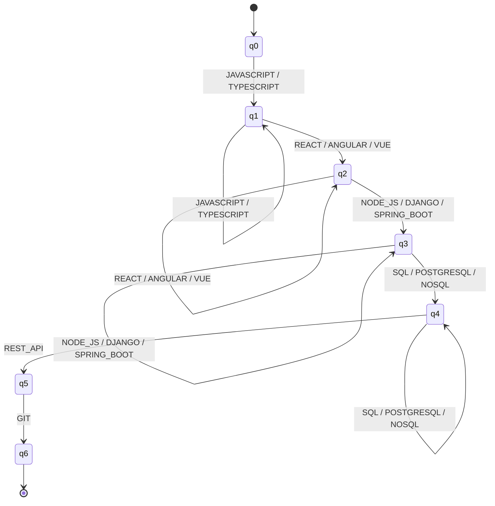
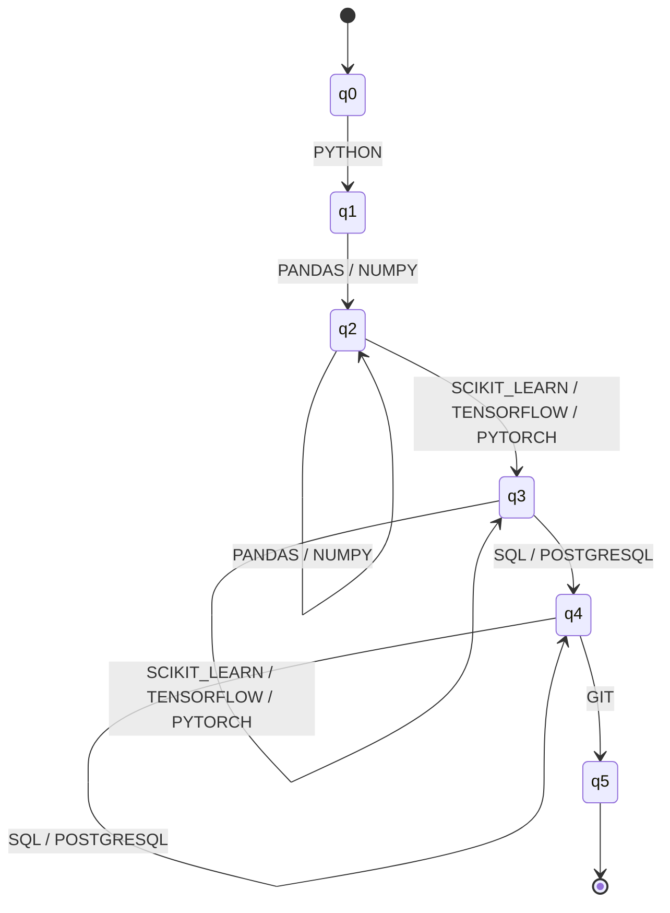
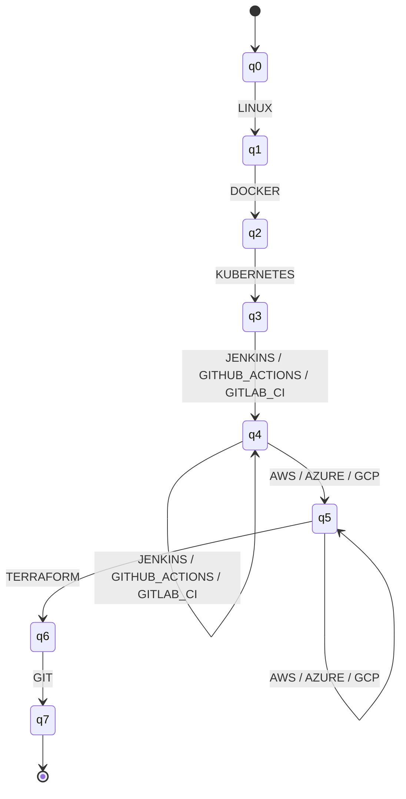
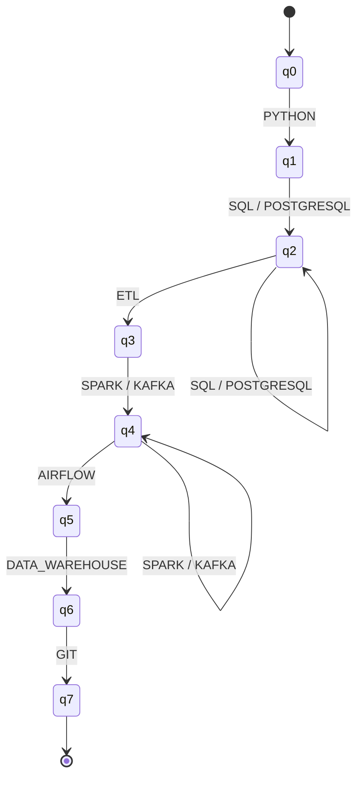

# ResumeLens - Finite Automata Formalization

## Purpose

This document describes the finite automata used during Stage 3 of ResumeLens:
Qualification Pattern Recognition.

The automata receive canonical qualification symbols produced by the
normalization stage. Before classification, the qualifications relevant to each
professional profile are filtered and organized according to the canonical order
defined for that profile.

Therefore, the automata do not process raw résumé text and do not perform
normalization.

ResumeLens currently defines four professional profile automata:

1. Full Stack Developer
2. Machine Learning Engineer
3. DevOps Engineer
4. Data Engineer

All four classifiers are implemented as deterministic finite automata (DFA).

---

# General Automata Design

Each automaton is formally described by the 5-tuple:

\[
M = (Q, \Sigma, \delta, q_0, F)
\]

where:

- \(Q\) is the finite set of states.
- \(\Sigma\) is the input alphabet of canonical qualification symbols.
- \(\delta\) is the transition function.
- \(q_0\) is the initial state.
- \(F\) is the set of accepting states.

The implemented automata are deterministic because, for every state and input
symbol, there is at most one possible next state. They contain no epsilon
transitions.

Transitions that are not explicitly defined cause the input sequence to be
rejected by the implementation.

Some states contain self-loops. These loops allow a candidate to have more than
one qualification belonging to the same category without being rejected.

For example, a Full Stack candidate may contain both `REACT` and `ANGULAR`.
Once the frontend requirement has been satisfied, another frontend technology
keeps the automaton in the same state.

---

# 1. Full Stack Developer

## Qualification Pattern

The Full Stack Developer automaton recognizes the following canonical pattern:

```text
Programming Language
    ->
Frontend Technology
    ->
Backend Technology
    ->
Database
    ->
REST API
    ->
Git
```

More specifically:

```text
(JAVASCRIPT | TYPESCRIPT)
(REACT | ANGULAR | VUE)
(NODE_JS | DJANGO | SPRING_BOOT)
(SQL | POSTGRESQL | NOSQL)
REST_API
GIT
```

## Formal Definition

The automaton is:

\[
M_{FS} = (Q_{FS}, \Sigma_{FS}, \delta_{FS}, q_0, F_{FS})
\]

### States

\[
Q_{FS} =
\{
q_0,q_1,q_2,q_3,q_4,q_5,q_6
\}
\]

The states have the following interpretation:

| State | Meaning |
|---|---|
| `q0` | No Full Stack category has been satisfied yet |
| `q1` | Programming language requirement satisfied |
| `q2` | Frontend requirement satisfied |
| `q3` | Backend requirement satisfied |
| `q4` | Database requirement satisfied |
| `q5` | REST API requirement satisfied |
| `q6` | Git requirement satisfied; accepted profile |

### Alphabet

\[
\Sigma_{FS} =
\{
JAVASCRIPT,
TYPESCRIPT,
REACT,
ANGULAR,
VUE,
NODE\_JS,
DJANGO,
SPRING\_BOOT,
SQL,
POSTGRESQL,
NOSQL,
REST\_API,
GIT
\}
\]

### Initial State

\[
q_0
\]

### Accepting States

\[
F_{FS} = \{q_6\}
\]

### Transition Function

| Current State | Input Symbol | Next State |
|---|---|---|
| `q0` | `JAVASCRIPT`, `TYPESCRIPT` | `q1` |
| `q1` | `JAVASCRIPT`, `TYPESCRIPT` | `q1` |
| `q1` | `REACT`, `ANGULAR`, `VUE` | `q2` |
| `q2` | `REACT`, `ANGULAR`, `VUE` | `q2` |
| `q2` | `NODE_JS`, `DJANGO`, `SPRING_BOOT` | `q3` |
| `q3` | `NODE_JS`, `DJANGO`, `SPRING_BOOT` | `q3` |
| `q3` | `SQL`, `POSTGRESQL`, `NOSQL` | `q4` |
| `q4` | `SQL`, `POSTGRESQL`, `NOSQL` | `q4` |
| `q4` | `REST_API` | `q5` |
| `q5` | `GIT` | `q6` |

All other transitions are undefined and therefore cause rejection.

## Transition Diagram



## Example

Accepted sequence:

```text
JAVASCRIPT, REACT, NODE_JS, POSTGRESQL, REST_API, GIT
```

State traversal:

```text
q0
--JAVASCRIPT--> q1
--REACT-------> q2
--NODE_JS-----> q3
--POSTGRESQL--> q4
--REST_API----> q5
--GIT---------> q6
```

The sequence finishes in `q6`, therefore it is accepted.

---

# 2. Machine Learning Engineer

## Qualification Pattern

The Machine Learning Engineer automaton recognizes:

```text
Python
    ->
Data Processing Library
    ->
Machine Learning Technology
    ->
Database
    ->
Git
```

More specifically:

```text
PYTHON
(PANDAS | NUMPY)
(SCIKIT_LEARN | TENSORFLOW | PYTORCH)
(SQL | POSTGRESQL)
GIT
```

## Formal Definition

\[
M_{ML} = (Q_{ML}, \Sigma_{ML}, \delta_{ML}, q_0, F_{ML})
\]

### States

\[
Q_{ML} =
\{
q_0,q_1,q_2,q_3,q_4,q_5
\}
\]

| State | Meaning |
|---|---|
| `q0` | No Machine Learning category has been satisfied yet |
| `q1` | Python requirement satisfied |
| `q2` | Data-processing library requirement satisfied |
| `q3` | Machine-learning technology requirement satisfied |
| `q4` | Database requirement satisfied |
| `q5` | Git requirement satisfied; accepted profile |

### Alphabet

\[
\Sigma_{ML} =
\{
PYTHON,
PANDAS,
NUMPY,
SCIKIT\_LEARN,
TENSORFLOW,
PYTORCH,
SQL,
POSTGRESQL,
GIT
\}
\]

### Initial State

\[
q_0
\]

### Accepting States

\[
F_{ML} = \{q_5\}
\]

### Transition Function

| Current State | Input Symbol | Next State |
|---|---|---|
| `q0` | `PYTHON` | `q1` |
| `q1` | `PANDAS`, `NUMPY` | `q2` |
| `q2` | `PANDAS`, `NUMPY` | `q2` |
| `q2` | `SCIKIT_LEARN`, `TENSORFLOW`, `PYTORCH` | `q3` |
| `q3` | `SCIKIT_LEARN`, `TENSORFLOW`, `PYTORCH` | `q3` |
| `q3` | `SQL`, `POSTGRESQL` | `q4` |
| `q4` | `SQL`, `POSTGRESQL` | `q4` |
| `q4` | `GIT` | `q5` |

All other transitions are undefined and therefore cause rejection.

## Transition Diagram



## Example

Accepted sequence:

```text
PYTHON, PANDAS, TENSORFLOW, POSTGRESQL, GIT
```

State traversal:

```text
q0
--PYTHON-------> q1
--PANDAS-------> q2
--TENSORFLOW---> q3
--POSTGRESQL---> q4
--GIT----------> q5
```

The sequence finishes in `q5`, therefore it is accepted.

---

# 3. DevOps Engineer

## Qualification Pattern

The DevOps Engineer automaton recognizes:

```text
Linux
    ->
Docker
    ->
Kubernetes
    ->
CI/CD Technology
    ->
Cloud Platform
    ->
Terraform
    ->
Git
```

More specifically:

```text
LINUX
DOCKER
KUBERNETES
(JENKINS | GITHUB_ACTIONS | GITLAB_CI)
(AWS | AZURE | GCP)
TERRAFORM
GIT
```

## Formal Definition

\[
M_{DO} = (Q_{DO}, \Sigma_{DO}, \delta_{DO}, q_0, F_{DO})
\]

### States

\[
Q_{DO} =
\{
q_0,q_1,q_2,q_3,q_4,q_5,q_6,q_7
\}
\]

| State | Meaning |
|---|---|
| `q0` | No DevOps category has been satisfied yet |
| `q1` | Linux requirement satisfied |
| `q2` | Docker requirement satisfied |
| `q3` | Kubernetes requirement satisfied |
| `q4` | CI/CD requirement satisfied |
| `q5` | Cloud platform requirement satisfied |
| `q6` | Terraform requirement satisfied |
| `q7` | Git requirement satisfied; accepted profile |

### Alphabet

\[
\Sigma_{DO} =
\{
LINUX,
DOCKER,
KUBERNETES,
JENKINS,
GITHUB\_ACTIONS,
GITLAB\_CI,
AWS,
AZURE,
GCP,
TERRAFORM,
GIT
\}
\]

### Initial State

\[
q_0
\]

### Accepting States

\[
F_{DO} = \{q_7\}
\]

### Transition Function

| Current State | Input Symbol | Next State |
|---|---|---|
| `q0` | `LINUX` | `q1` |
| `q1` | `DOCKER` | `q2` |
| `q2` | `KUBERNETES` | `q3` |
| `q3` | `JENKINS`, `GITHUB_ACTIONS`, `GITLAB_CI` | `q4` |
| `q4` | `JENKINS`, `GITHUB_ACTIONS`, `GITLAB_CI` | `q4` |
| `q4` | `AWS`, `AZURE`, `GCP` | `q5` |
| `q5` | `AWS`, `AZURE`, `GCP` | `q5` |
| `q5` | `TERRAFORM` | `q6` |
| `q6` | `GIT` | `q7` |

All other transitions are undefined and therefore cause rejection.

## Transition Diagram



## Example

Accepted sequence:

```text
LINUX, DOCKER, KUBERNETES, GITHUB_ACTIONS, AWS, TERRAFORM, GIT
```

State traversal:

```text
q0
--LINUX-----------> q1
--DOCKER----------> q2
--KUBERNETES------> q3
--GITHUB_ACTIONS--> q4
--AWS-------------> q5
--TERRAFORM-------> q6
--GIT-------------> q7
```

The sequence finishes in `q7`, therefore it is accepted.

---

# 4. Data Engineer

## Qualification Pattern

The Data Engineer automaton recognizes:

```text
Python
    ->
Database Technology
    ->
ETL
    ->
Distributed Data Technology
    ->
Airflow
    ->
Data Warehouse
    ->
Git
```

More specifically:

```text
PYTHON
(SQL | POSTGRESQL)
ETL
(SPARK | KAFKA)
AIRFLOW
DATA_WAREHOUSE
GIT
```

## Formal Definition

\[
M_{DE} = (Q_{DE}, \Sigma_{DE}, \delta_{DE}, q_0, F_{DE})
\]

### States

\[
Q_{DE} =
\{
q_0,q_1,q_2,q_3,q_4,q_5,q_6,q_7
\}
\]

| State | Meaning |
|---|---|
| `q0` | No Data Engineer category has been satisfied yet |
| `q1` | Python requirement satisfied |
| `q2` | Database requirement satisfied |
| `q3` | ETL requirement satisfied |
| `q4` | Distributed-data technology requirement satisfied |
| `q5` | Airflow requirement satisfied |
| `q6` | Data Warehouse requirement satisfied |
| `q7` | Git requirement satisfied; accepted profile |

### Alphabet

\[
\Sigma_{DE} =
\{
PYTHON,
SQL,
POSTGRESQL,
ETL,
SPARK,
KAFKA,
AIRFLOW,
DATA\_WAREHOUSE,
GIT
\}
\]

### Initial State

\[
q_0
\]

### Accepting States

\[
F_{DE} = \{q_7\}
\]

### Transition Function

| Current State | Input Symbol | Next State |
|---|---|---|
| `q0` | `PYTHON` | `q1` |
| `q1` | `SQL`, `POSTGRESQL` | `q2` |
| `q2` | `SQL`, `POSTGRESQL` | `q2` |
| `q2` | `ETL` | `q3` |
| `q3` | `SPARK`, `KAFKA` | `q4` |
| `q4` | `SPARK`, `KAFKA` | `q4` |
| `q4` | `AIRFLOW` | `q5` |
| `q5` | `DATA_WAREHOUSE` | `q6` |
| `q6` | `GIT` | `q7` |

All other transitions are undefined and therefore cause rejection.

## Transition Diagram



## Example

Accepted sequence:

```text
PYTHON, SQL, ETL, SPARK, AIRFLOW, DATA_WAREHOUSE, GIT
```

State traversal:

```text
q0
--PYTHON---------> q1
--SQL------------> q2
--ETL------------> q3
--SPARK----------> q4
--AIRFLOW--------> q5
--DATA_WAREHOUSE-> q6
--GIT------------> q7
```

The sequence finishes in `q7`, therefore it is accepted.

---

# Why DFA?

All four profile recognizers are deterministic finite automata.

For every state \(q\) and qualification symbol \(a\), the implementation defines
at most one destination state:

\[
\delta(q,a)=q'
\]

There is never a case where the same state and the same input symbol can lead to
two different states.

For example, in the Full Stack automaton:

\[
\delta(q_1, REACT)=q_2
\]

and there is no second transition from `q1` using `REACT`.

The automata also contain no epsilon transitions.

For these reasons, DFA is an appropriate model for the ResumeLens qualification
patterns after the qualifications have been normalized and placed in canonical
order.

---

# Relationship with the ResumeLens Pipeline

The finite automata represent only Stage 3 of the system.

```text
Résumé
   |
   v
Regular Expression Extraction
   |
   v
Finite-State Transducer Normalization
   |
   v
Profile-specific Filtering and Canonical Ordering
   |
   v
Finite Automata Classification
   |
   v
Accepted Professional Profiles
```

A qualification that does not belong to the alphabet of a specific profile is
removed before that profile is evaluated.

This means that possessing additional unrelated qualifications does not cause
automatic rejection.

For example:

```text
PYTHON
SQL
DOCKER
ETL
SPARK
REACT
AIRFLOW
DATA_WAREHOUSE
GIT
```

can still satisfy the Data Engineer pattern.

For the Data Engineer classifier, `DOCKER` and `REACT` are not part of the
profile alphabet, so the prepared sequence becomes:

```text
PYTHON
SQL
ETL
SPARK
AIRFLOW
DATA_WAREHOUSE
GIT
```

which is accepted by the Data Engineer automaton.